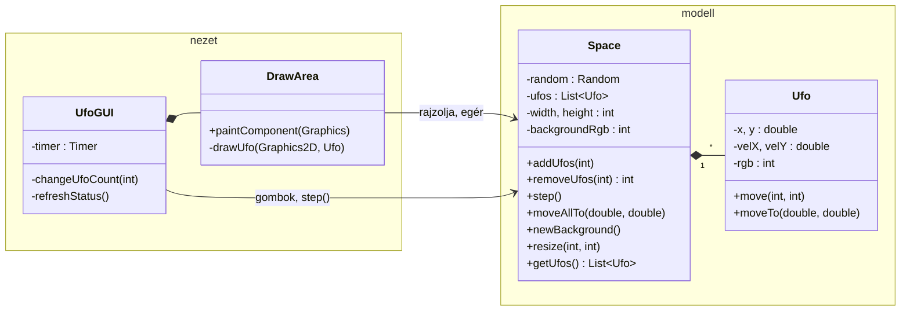
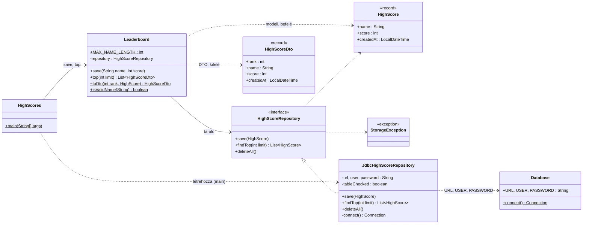

# 10. hét – Elemi grafika és animáció; bevezetés az adatbázisokba

Ezen a héten két új dolog jön, és mindkettő a **3. beadandó** alapja. Az első az **elemi grafika**: eddig gombokból és címkékből építettük a felületet, most mi magunk rajzolunk egy panelre (`paintComponent`), és egy `Timer`-rel animáljuk a rajzot. A második az **adatbázis**: a 3. beadandó játékai a játék végén az eredményt adatbázisba mentik, és a 10 legjobbat visszaolvassák. Ezen a héten a legkisebb működő példán nézzük meg, hogyan beszél egy Java-program egy adatbázissal; a következő héten ezt tesszük be a játékokba.

## Áttekintés

| Mappa        | Típus   | Téma                                                                                                                         |
| ------------ | ------- | ---------------------------------------------------------------------------------------------------------------------------- |
| `UFOs`       | Példa   | UFO-k repkednek egy panelen, **kiinduló változat**: `paintComponent`, `Timer`, egér; a szabályok a nézetben, a modell az AWT-től függ |
| `UFOsMV`     | Feladat | Ugyanez **MV-ben**: a `Space` modell Swing nélkül, a `DrawArea` csak rajzol, egy `Timer` kettő helyett; 21 JUnit teszt        |
| `HighScores` | Példa   | **Adatbázis-bevezető**: konzolos ranglista menüvel (eredmény felvétele, a 10 legjobb, törlés); egy táblába írunk és olvasunk JDBC-vel; a felület csak a **backendet** hívja (`Leaderboard`), az adatbázist a **tároló** fedi el (`JdbcHighScoreRepository`), a backend a **modellel** (`HighScore`) dolgozik, a felület **DTO**-t kap (`HighScoreDto`); SQLite (alapértelmezett) vagy MySQL Dockerben; code-first; 20 JUnit teszt |

A projektek Maven-projektek, mint a 8. héten: NetBeansben és IntelliJ-ben is megnyithatók, parancssorból is fordulnak (ld. [Futtatás](#futtatás)).

---

## 1. rész – Elemi grafika

### A program – UFO-k

Egy panelen UFO-k repkednek: mindegyiknek véletlen helye, sebessége és színe van, a panel szélén átfordulnak a túloldalra, és néha színt váltanak. A gombokkal UFO-kat adhatunk hozzá vagy vehetünk el, a hátteret véletlen színre válthatjuk, az egérrel húzva pedig az összes UFO-t egy pontba rántjuk.

```
┌ UFOs ───────────────────────────────────────────────────────────┐
│ UFOs: 10                                                        │  ← állapotsor (csak az MV változatban)
├─────────────────────────────────────────────────────────────────┤
│            ◯                                                    │
│        ▬▬▬▬▬▬▬                      ◯                           │  ← a rajzterület (DrawArea):
│                                 ▬▬▬▬▬▬▬                         │     paintComponent rajzolja,
│                   ◯                                             │     a Timer 30 ms-onként lépteti
│               ▬▬▬▬▬▬▬                            ◯              │
│                                              ▬▬▬▬▬▬▬            │
├─────────────────────────────────────────────────────────────────┤
│ [Change background] [-1000] [-100] [-10] [-1] [1] [10] [100] [1000] │  ← gombsor
└─────────────────────────────────────────────────────────────────┘
```

### Hogyan rajzolunk Swingben?

Eddig a komponensek (gomb, címke) maguk rajzolták ki magukat. Ha valami mást akarunk látni, egy `JPanel`-ből származtatunk, és **felülírjuk a `paintComponent` metódust**:

```java
class DrawArea extends JPanel {
    @Override
    protected void paintComponent(Graphics g) {
        super.paintComponent(g);               // letörli a területet (a háttérszínnel)
        Graphics2D g2 = (Graphics2D) g;
        g2.setColor(Color.RED);
        g2.fillOval(100, 50, 200, 30);         // bal felső sarok (x, y), szélesség, magasság
    }
}
```

Amit tudni kell róla:

| Szabály | Miért |
| --- | --- |
| **Soha nem mi hívjuk** a `paintComponent`-et | A Swing hívja, amikor a komponenst ki kell rajzolni: először, az ablak átméretezésekor, ha egy másik ablak eltakarta, vagy ha mi kértük. |
| Ha változott, amit rajzolunk, **`repaint()`**-et hívunk | A `repaint()` csak *kéri* az újrarajzolást; a Swing hamarosan (az EDT-n) meghívja a `paintComponent`-et. Több `repaint()` kérés összevonódik. |
| Először **`super.paintComponent(g)`** | Letörli a területet. Enélkül az előző képkocka ott marad, és az UFO-k "csíkot húznak". |
| A rajzolás közben **nem változtatjuk a komponens állapotát** | Pl. nincs `setBackground` a `paintComponent`-ben: az újabb újrarajzolást kérne, ami újabb `paintComponent`-et... A háttér egy kitöltött téglalap. |
| A `Graphics2D` a "ceruza" | `setColor`, `fillOval`, `fillRect`, `drawLine`, `fillPolygon`, `drawString`, `drawImage`; a `setRenderingHint(ANTIALIASING)` elsimítja a széleket. |
| Az `(x, y)` a **bal felső sarok**, az y lefelé nő | Nem a matematikai koordináta-rendszer: a (0, 0) a panel bal felső sarka. |

A Swing **duplán pufferel**: a `paintComponent` egy memóriabeli képre rajzol, és a kész kép kerül a képernyőre, ezért nem villog az animáció. Ezt nem kell beállítani, a `JPanel` alapból így működik.

### Animáció: a `Timer`

Az animáció nem más, mint sok állókép egymás után. Egy `javax.swing.Timer` adott időnként (itt 30 ms, azaz kb. 33 képkocka másodpercenként) meghív egy eseménykezelőt, ami **lépteti a modellt és `repaint()`-et kér**:

```java
timer = new Timer(30, e -> {
    space.step();          // a modell: minden UFO továbbmegy
    drawArea.repaint();    // a nézet: kérjük az újrarajzolást
});
timer.start();
```

A `Timer` eseménykezelője az **EDT-n** fut (mint a gomboké), ezért nyúlhat a komponensekhez és a modellhez is: nincs szálkezelési gond. A 3. beadandó játékai (mozgó sprite-ok, időzítő) pontosan így működnek: egy `Timer`, ami ütemenként lépteti a játékot.

### Egér

Az egér eseményei (`MouseListener`: kattintás, lenyomás, felengedés; `MouseMotionListener`: mozgás, húzás) a komponenshez adhatók. A `MouseAdapter` mindkét interfészt üres metódusokkal megvalósítja, így csak azt írjuk felül, ami kell:

```java
addMouseMotionListener(new MouseAdapter() {
    @Override
    public void mouseDragged(MouseEvent e) {
        space.moveAllTo(e.getX() - Ufo.WIDTH / 2.0, e.getY() - Ufo.HEIGHT / 2.0);
        repaint();
    }
});
```

(A billentyűzet a 11. héten jön, a WASD-irányítással.)

### Kiinduló változat – mi a gond vele?

**Projekt:** `UFOs`

| Osztály    | Feladat                                                                                                 |
| ---------- | ------------------------------------------------------------------------------------------------------- |
| `UFOs`     | belépési pont                                                                                           |
| `UFO`      | egy UFO: hely, sebesség, `java.awt.Color`; **maga rajzolja ki magát** (`draw(Graphics2D)`); `move` átfordulással |
| `DrawArea` | a rajzterület: tartja az UFO-k listáját, a `paintComponent`-ben `setBackground`-ot hív, az egérkezelője maga mozgatja az UFO-kat |
| `UFOGUI`   | az ablak, a gombok, **és a szabályok**: az UFO-k listája, a hozzáadás/elvétel (`UFOAdder`), két `Timer` (mozgás 30 ms, színváltás 10 ms, 1/1000 eséllyel) |

Működik, de:

- **A szabályok a nézetben vannak.** Hány UFO van, hogyan keletkezik egy új, milyen eséllyel vált színt: mind az `UFOGUI`-ban. Teszt nem írható rájuk.
- **A modell az AWT-től függ.** Az `UFO` `Color`-t tárol és `Graphics2D`-re rajzol: felület nélkül nem is példányosítható értelmesen.
- **Három osztály osztozik egy `ArrayList`-en** (`UFOGUI`, `DrawArea`, a Timerek), és egyik sem a gazdája.
- **Két `Timer`** csinálja azt, amit egy is tudna.
- `setBackground` a `paintComponent`-ben: a rajzolás közben változtatjuk a komponenst.

### MV változat

**Projekt:** `UFOsMV`

| Osztály    | Réteg  | Feladat                                                                                                  |
| ---------- | ------ | -------------------------------------------------------------------------------------------------------- |
| `UFOs`     | –      | belépési pont                                                                                            |
| `Ufo`      | modell | egy UFO: hely, sebesség, szín **egész számként** (0xRRGGBB); `move(width, height)` átfordulással, `moveTo` |
| `Space`    | modell | a tér: az UFO-k listájának **gazdája**, a méret, a háttérszín, **és a szabályok**: `addUfos`, `removeUfos`, `step` (léptetés + színváltás), `moveAllTo`, `newBackground`; a `Random`-ot a konstruktor kapja |
| `DrawArea` | nézet  | a rajzterület: a `paintComponent` a modellt rajzolja; az egér a modellt hívja és `repaint`-et kér; átméretezéskor `space.resize` |
| `UfoGUI`   | nézet  | az ablak, a gombok, az állapotsor, **egy** `Timer`: `space.step()` + `repaint()`                           |
| `UfoTest`, `SpaceTest` | teszt | 21 JUnit teszt a modellhez                                                                      |



A `step` a kulcs: egy ütemnyi "fizika", Swing nélkül:

```java
public void step() {
    for (Ufo ufo : ufos) {
        ufo.move(width, height);
        if (random.nextDouble() < RECOLOR_PROBABILITY) {
            ufo.setRgb(randomRgb());
        }
    }
}
```

A nézet két helyen olvassa a modellt: a `paintComponent`-ben (háttérszín, UFO-k) és az állapotsorban (darabszám). A `drawUfo(g2, ufo)` az egyetlen hely, ahol egy UFO kinézete el van döntve: a modell nem tudja, hogy kupolából és testből áll.

| | `UFOs` | `UFOsMV` |
| --- | --- | --- |
| Az UFO-k listájának gazdája | senki (három osztály módosítja) | `Space` |
| A szín | `java.awt.Color` a modellben | `int` a modellben, `Color` a nézetben |
| Ki rajzolja az UFO-t | az `UFO` maga (`draw`) | a `DrawArea.drawUfo` |
| A háttér | `setBackground` a `paintComponent`-ben | a modell `backgroundRgb`-je, kitöltött téglalap |
| Timerek | kettő (mozgás, szín) | egy (`step` mindkettőt csinálja) |
| A tér mérete | a `Timer` a `drawArea.getSize()`-t kérdezi | a modellé; átméretezéskor `resize` |
| Véletlen | `Math.random()` | `Random` a konstruktorból (tesztelhető) |
| Tesztek | – | 21 |

### Tesztek

`UfoTest`: a lépés hozzáadja a sebességet; mind a négy szélen átfordul a túloldalra; a `moveTo` a sebességet nem változtatja. `SpaceTest`: az új tér (darabszám, az UFO-k a téren belül, lassúak; negatív darabszám és nem pozitív méret elutasítva; azonos mag azonos teret ad); hozzáadás és elvétel (a legrégebbiek mennek; több elvétele, mint ahány van, nem hiba); a lista kívülről nem módosítható; a lépés (minden UFO a sebességével megy; 10 000 lépés után is a téren belül vannak; néha színt váltanak); egér, háttér, átméretezés.

---

## 2. rész – Bevezetés az adatbázisokba

### Miért adatbázis?

A 3. beadandóban a játék végén a játékos nevét és pontszámát el kell menteni, és egy menüpontból a 10 legjobbat meg kell mutatni. Ezt egy szövegfájllal is meg lehetne oldani (7. hét), de:

| Fájl | Adatbázis |
| --- | --- |
| mi találjuk ki a formátumot, mi írjuk a beolvasót | a szerkezet (tábla, oszlopok, típusok) adott, az adatbázis őrzi |
| a "10 legjobb" = mindent beolvasunk, rendezünk, levágunk | `SELECT ... ORDER BY score DESC LIMIT 10` – az adatbázis dolga |
| két program egyszerre írja: sérül | egyszerre több felhasználó, tranzakciók |
| ha a program félúton leáll, a fájl félkész | vagy megtörténik a művelet, vagy nem |

Nagyobb programokban (web, mobil, vállalati) az adatok gyakorlatilag mindig adatbázisban vannak. A beadandóhoz az alapok kellenek: egy tábla, beszúrás, lekérdezés.

### A fogalmak egy percben

Egy **relációs adatbázis** táblákból áll. Egy **tábla** olyan, mint egy táblázat: **oszlopai** vannak (névvel és típussal), és **sorai** (egy sor = egy eredmény). Az adatbázissal **SQL**-ben beszélünk:

```sql
-- A tábla létrehozása (egyszer). Az IF NOT EXISTS miatt nem hiba, ha már van.
CREATE TABLE IF NOT EXISTS highscores (
    name       VARCHAR(50) NOT NULL,     -- szöveg, legfeljebb 50 karakter, kötelező
    score      INTEGER     NOT NULL,     -- egész szám
    created_at TIMESTAMP   NOT NULL      -- dátum és idő
);

-- Egy sor beszúrása
INSERT INTO highscores (name, score, created_at) VALUES ('Anna', 42, '2026-11-20 10:15:30');

-- A 10 legjobb: pontszám szerint csökkenő, azonos pontnál a korábbi előrébb
SELECT name, score, created_at
FROM highscores
ORDER BY score DESC, created_at ASC
LIMIT 10;

-- Törlés (minden sor)
DELETE FROM highscores;
```

Ennyi SQL a beadandóhoz elég. (Ha a feladat "a győztes eredményét növeli, vagy új sort szúr be", ahhoz `UPDATE` is kell, ld. a 11. hetet.)

### JDBC – ahogy a Java az adatbázissal beszél

A **JDBC** (Java Database Connectivity) a JDK része: egységes felület minden adatbázishoz. Az adatbázis-specifikus részt a **driver** (egy jar, a Maven tölti le a `pom.xml` alapján) tartalmazza. A program ugyanaz, akár SQLite, akár MySQL van mögötte: csak a **JDBC URL** más.

| Osztály (`java.sql`) | Mire való |
| --- | --- |
| `DriverManager.getConnection(url, user, password)` | kapcsolat nyitása; az URL eleje (`jdbc:sqlite:`, `jdbc:mysql:`) választja ki a drivert |
| `Connection` | egy kapcsolat; **le kell zárni** → try-with-resources |
| `PreparedStatement` | egy SQL-utasítás `?` helyekkel; `setString(1, név)`, `setInt(2, pont)`; `executeUpdate()` (INSERT/UPDATE/DELETE) vagy `executeQuery()` (SELECT) |
| `ResultSet` | a lekérdezés eredménye soronként: `while (rows.next()) { rows.getString("name"); rows.getInt("score"); }` |
| `SQLException` | ellenőrzött kivétel: nem fut a szerver, rossz jelszó, nincs ilyen tábla, ... |

Egy beszúrás és egy lekérdezés (a `JdbcHighScoreRepository`-ból):

```java
public void save(HighScore highScore) throws StorageException {
    try (Connection connection = connect();
         PreparedStatement statement = connection.prepareStatement(
                 "INSERT INTO highscores (name, score, created_at) VALUES (?, ?, ?)")) {
        statement.setString(1, highScore.name());
        statement.setInt(2, highScore.score());
        statement.setTimestamp(3, Timestamp.valueOf(highScore.createdAt()));
        statement.executeUpdate();
    } catch (SQLException e) {
        throw new StorageException("Az eredmény mentése nem sikerült: " + e.getMessage(), e);
    }
}

public List<HighScore> findTop(int limit) throws StorageException {
    List<HighScore> result = new ArrayList<>();
    try (Connection connection = connect();
         PreparedStatement statement = connection.prepareStatement(
                 "SELECT name, score, created_at FROM highscores ORDER BY score DESC, created_at ASC LIMIT ?")) {
        statement.setInt(1, limit);
        try (ResultSet rows = statement.executeQuery()) {
            while (rows.next()) {
                result.add(new HighScore(rows.getString("name"), rows.getInt("score"),
                        rows.getTimestamp("created_at").toLocalDateTime()));
            }
        }
    } catch (SQLException e) {
        throw new StorageException("A ranglista olvasása nem sikerült: " + e.getMessage(), e);
    }
    return result;
}
```

A `SQLException`-t a tároló **saját kivétellé** (`StorageException`) csomagolja: a hívó így nem függ a `java.sql` csomagtól, és nem érdekli, hogy a hiba egy SQL-szerveré vagy egy fájlé volt.

**Miért `?` és nem szövegösszefűzés?** Mert a `"... VALUES ('" + name + "', ...)"` alakú SQL-be a felhasználó bármit beírhat a névnek, akár egy másik SQL-utasítást is (**SQL injection**). A `PreparedStatement` a `?` helyére kerülő értéket *adatként* adja át, soha nem értelmezi SQL-ként. Ez nem opció, hanem szabály: a felhasználótól jövő érték **mindig** `?`-rel kerül az SQL-be. A 11. héten részletesen.

### SQLite vagy MySQL?

A projektekben **mindkettő benne van**, és a kód ugyanaz; csak a `Database.java` három sora dönti el, melyiket használjuk.

| | SQLite | MySQL |
| --- | --- | --- |
| Mi az | egy **fájl** (`highscores.db`) a projekt mappájában; a driver tartalmazza a teljes adatbázismotort | egy **szerver**, ami a háttérben fut, és hálózaton (porton) fogad kapcsolatokat |
| Telepítés | semmi: a Maven letölti a drivert | kell egy futó szerver: nálunk Docker-konténer (ld. lejjebb) |
| Felhasználó, jelszó | nincs | van |
| Mire jó | egyfelhasználós asztali és mobil programok (böngészők, telefonok, a beadandó) | több felhasználó, webes és vállalati rendszerek |
| A beadandóban | **alapértelmezett**: mindig működik, bárhol | opció: ha a Docker fut, egy kommentcserével átváltható |

```java
// Database.java – SQLite (alapértelmezett)
public static final String URL = "jdbc:sqlite:highscores.db";
public static final String USER = null;
public static final String PASSWORD = null;

// MySQL (Docker): a fenti három sort kommentezzük ki, ezeket vegyük elő
// public static final String URL = "jdbc:mysql://localhost:3306/progtech";
// public static final String USER = "progtech";
// public static final String PASSWORD = "progtech";
```

Az adatbázis úgy tárolja az értékeket, ahogy neki a legjobb (a SQLite például a dátumot számként, a MySQL dátumként); a Java-oldalon a `getTimestamp` mindkettőből ugyanazt a `LocalDateTime`-ot adja. A tárolás módja az adatbázis dolga, a program a JDBC-n keresztül egységesen látja.

### Code-first: a táblát a program hozza létre

A `JdbcHighScoreRepository` minden kapcsolatnyitáskor (pontosabban az elsőnél) lefuttatja a `CREATE TABLE IF NOT EXISTS`-t. Ezért **nem kell előre semmit csinálni az adatbázisban**: egy üres SQLite-fájl vagy egy frissen indított MySQL-konténer is azonnal jó. Miért így?

- **Bárki elindítja**, aki letölti a projektet: nem kell SQL-szkriptet futtatnia, adatbázist kattintgatnia. (Az oktató is.)
- **A tábla szerkezete a kódban van**, a kóddal együtt verziózva. Ha új oszlop kell, a kód és a tábla egyszerre változik.
- **A tesztek** egy ideiglenes, üres fájlon futnak, és a tároló ott is létrehozza a táblát.

Ez az, amit a nagy keretrendszerek (JPA/Hibernate, Entity Framework) "code-first"-nek hívnak, a legegyszerűbb formájában. Ha valaki mégis **kézzel** akarja megnézni vagy létrehozni a táblát (pl. egy adatbázis-böngészőben), ugyanezt az SQL-t futtathatja:

```sql
-- SQLite és MySQL: ugyanez a projektek CREATE_TABLE konstansa
CREATE TABLE IF NOT EXISTS highscores (
    name       VARCHAR(50) NOT NULL,
    score      INTEGER     NOT NULL,
    created_at TIMESTAMP   NOT NULL
);
```

Ha **azonosító (kulcs) oszlopot** is akarunk (a ranglistához nem kell, de egy "igazi" táblán szokás), az a két adatbázisban másképp írandó, ezért a mintából kihagytuk:

```sql
-- SQLite
CREATE TABLE IF NOT EXISTS highscores (
    id         INTEGER PRIMARY KEY AUTOINCREMENT,
    name       VARCHAR(50) NOT NULL,
    score      INTEGER     NOT NULL,
    created_at TIMESTAMP   NOT NULL
);

-- MySQL
CREATE TABLE IF NOT EXISTS highscores (
    id         INT AUTO_INCREMENT PRIMARY KEY,
    name       VARCHAR(50) NOT NULL,
    score      INTEGER     NOT NULL,
    created_at TIMESTAMP   NOT NULL
);
```

MySQL-ben maga az **adatbázis** (a `progtech`) sem kézzel jön létre: a konténer indításakor a `MYSQL_DATABASE` környezeti változó mondja meg, hogy legyen egy ilyen, és a `MYSQL_USER` / `MYSQL_PASSWORD` a felhasználót, aki mindent csinálhat benne. Kézzel ugyanez (root-ként):

```sql
CREATE DATABASE progtech;
CREATE USER 'progtech'@'%' IDENTIFIED BY 'progtech';
GRANT ALL PRIVILEGES ON progtech.* TO 'progtech'@'%';
FLUSH PRIVILEGES;
```

### Docker: a MySQL-szerver egy konténerben

**Mi az a Docker, és miért így?** Egy adatbázis-szervert hagyományosan telepíteni kell a gépre: telepítő, szolgáltatás, ami a háttérben mindig fut, konfigurációs fájlok, és ha egyszer el akarjuk távolítani, maradnak nyomai. A **Docker** ehelyett a programot egy **konténerben** futtatja: egy elszigetelt, előre összecsomagolt környezetben (**image**), amiben benne van a MySQL és minden, ami kell neki. A konténer:

- **egy paranccsal indul** és egy paranccsal törlődik, nyom nélkül;
- **mindenkinél ugyanaz**: a `mysql:latest` image Windowson, macOS-en és Linuxon ugyanazt a szervert adja, ugyanazzal a beállítással;
- **elszigetelt**: nem nyúl a gép többi részéhez, csak azt a portot látjuk belőle, amit kiengedünk (3306);
- **nem virtuális gép**: nem egy egész operációs rendszer fut benne, hanem csak a program, ezért másodpercek alatt indul, és kevés memóriát eszik.

Ez ma az iparban a szokásos módja a fejlesztői adatbázisnak (és sok minden másnak: web-szerver, üzenetsor, cache). A felhőszolgáltatók (Azure, AWS, Google Cloud) is kínálnak kész MySQL-t: ott ugyanígy egy URL-t, felhasználót és jelszót kapunk, és a programunk *ugyanaz* marad, csak a `Database.java` változik. Most a konténernél maradunk, mert ingyenes, offline is működik, és a saját gépünkön van.

#### Telepítés lépésről lépésre

1. **Docker Desktop letöltése:** https://www.docker.com/products/docker-desktop/ – Windows (x86-64), macOS (Apple Silicon vagy Intel: a *About This Mac* mutatja), Linux. Személyes és oktatási használatra ingyenes.
2. **Windows:** a telepítő a **WSL 2**-t használja (Windows Subsystem for Linux); ha még nincs, a telepítő bekapcsolja, és újraindítást kér. Hagyjuk a *Use WSL 2 instead of Hyper-V* opciót bekapcsolva. **macOS:** a `.dmg`-ből az Applications mappába húzzuk, első indításkor rendszergazda-jelszót kér.
3. **Indítsuk el a Docker Desktopot.** Amíg fut (a tálcán / menüsoron a bálna ikon), addig tudunk konténereket indítani. (Nem kell regisztrálni vagy bejelentkezni, a *Skip* / *Continue without signing in* is jó.)
4. **Ellenőrzés** egy terminálban (PowerShell, Terminal):

   ```
   docker version
   ```

   Ha a `Client` és a `Server` rész is megjelenik, működik. Ha "Cannot connect to the Docker daemon" / "error during connect": a Docker Desktop nem fut, indítsuk el, és várjuk meg, amíg a bálna ikon megáll.

#### A MySQL-konténer indítása

Két egyenértékű mód van. **(a)** Egyetlen parancs (egy sorban):

```
docker run --name progtech-mysql -e MYSQL_ROOT_PASSWORD=root -e MYSQL_DATABASE=progtech -e MYSQL_USER=progtech -e MYSQL_PASSWORD=progtech -p 3306:3306 -d mysql:latest
```

| Rész | Jelentése |
| --- | --- |
| `docker run ... mysql:latest` | indíts egy konténert a `mysql` image legfrissebb változatából (első alkalommal letölti, kb. 600 MB; utána a gépen marad) |
| `--name progtech-mysql` | a konténer neve: így hivatkozunk rá a többi parancsban |
| `-e MYSQL_ROOT_PASSWORD=root` | a `root` (admin) jelszava |
| `-e MYSQL_DATABASE=progtech` | induláskor hozza létre a `progtech` adatbázist |
| `-e MYSQL_USER=progtech -e MYSQL_PASSWORD=progtech` | és egy `progtech` felhasználót ezzel a jelszóval, aki a `progtech` adatbázisban mindent csinálhat |
| `-p 3306:3306` | a gépünk 3306-os portja a konténer 3306-os portjára mutasson: a programunk a `localhost:3306`-on éri el |
| `-d` | a háttérben fusson (detached) |

**(b)** A projektben lévő `compose.yaml` fájllal, ami ugyanezt írja le olvashatóan (a projekt mappájából):

```
docker compose up -d
```

Ez az iparban megszokott mód: a beállítások egy fájlban vannak a projekt mellett, és a `compose.yaml` egy nevesített **kötetet** (volume) is létrehoz, amiben az adatok a konténer törlése után is megmaradnak.

A szerver az első indításkor kb. 10–20 másodperc alatt áll fel (inicializálja az adatbázist). A `docker logs progtech-mysql` végén a `ready for connections` sor jelzi, hogy kész.

#### Hol találom a kapcsolat adatait?

A programba (`Database.java`) ezek kellenek: a **gép és port** (`localhost:3306`), az **adatbázis neve** (`progtech`), a **felhasználó** és a **jelszó** (`progtech` / `progtech`). Ha valaki más értékekkel indította a konténert, így olvasható ki:

- **Terminálból:**

  ```
  docker ps                                         # a futó konténerek: a PORTS oszlop (0.0.0.0:3306->3306/tcp)
  docker inspect progtech-mysql                     # minden adat JSON-ban: az "Env" lista (MYSQL_USER, ...), a "Ports"
  docker inspect progtech-mysql --format "{{json .Config.Env}}"     # csak a környezeti változók
  ```

- **Docker Desktopban:** a bal oldali *Containers* listában a `progtech-mysql` sor **Port(s)** oszlopa (`3306:3306`); a névre kattintva az **Inspect** fül *Environment* része mutatja a `MYSQL_DATABASE`, `MYSQL_USER`, `MYSQL_PASSWORD` értékét. A **Logs** fülön a szerver naplója, az **Exec** fülön egy terminál a konténerben.

#### Belenézni az adatbázisba

Nem kell MySQL-klienst telepíteni a gépre: a konténerben benne van. Terminálból:

```
docker exec -it progtech-mysql mysql -u progtech -p
```

(A jelszó: `progtech`.) Ezután SQL-parancsokat adhatunk ki:

```sql
USE progtech;
SHOW TABLES;
SELECT * FROM highscores ORDER BY score DESC;
EXIT
```

Ugyanez a Docker Desktop **Exec** fülén is megy (`mysql -u progtech -p`). Grafikus eszköz, ha valaki szeretne: az **IntelliJ IDEA** *Database* ablaka (Ultimate), a **NetBeans** *Services ▸ Databases* (New Connection, a MySQL-driver jar-ját a `~/.m2` mappából), **DBeaver** (ingyenes, minden adatbázishoz), **MySQL Workbench**. Mindegyiknek ugyanazt adjuk meg: host `localhost`, port `3306`, database `progtech`, user és password `progtech`.

A **SQLite**-fájlhoz: **DB Browser for SQLite** (ingyenes, https://sqlitebrowser.org/), DBeaver, az IntelliJ *Database* ablaka, vagy a VS Code *SQLite Viewer* bővítménye. Megnyitjuk a projekt mappájában lévő `highscores.db`-t, és látjuk a táblát.

#### Leállítás, újraindítás, törlés

```
docker stop progtech-mysql        # leállítás (az adatok megmaradnak)
docker start progtech-mysql       # újraindítás (ugyanazokkal az adatokkal)
docker rm -f progtech-mysql       # a konténer törlése; a "docker run"-nal indítottnál az adatok is elvesznek
docker compose stop               # ugyanez compose-zal, a projekt mappájából
docker compose down -v            # a konténer ÉS a kötet törlése (tiszta lap)
```

A Docker Desktop *Containers* listájában ugyanezek a gombok (▶ ■ 🗑) vannak. A gép újraindítása után a Docker Desktopot el kell indítani, és a konténert is (`docker start`), vagy a Docker Desktop beállításaiban: *Start Docker Desktop when you sign in*.

#### Gyakori hibák

| Üzenet (a `SQLException`-ből) | Ok és megoldás |
| --- | --- |
| `Communications link failure` / `Connection refused` | nem fut a konténer (`docker ps`), vagy még nem állt fel (`docker logs`); vagy nem 3306-ra van kiengedve a port |
| `Access denied for user 'progtech'@'...'` | rossz felhasználó vagy jelszó: nézzük meg a konténer `Env` adatait |
| `Unknown database 'progtech'` | a konténer nem ezzel a `MYSQL_DATABASE`-zel indult; vagy más néven; `docker inspect` |
| `port is already allocated` (a `docker run`-nál) | a 3306 foglalt: fut már egy másik MySQL (telepített vagy konténer); állítsuk le, vagy adjuk ki más porton: `-p 3307:3306` és az URL-ben `localhost:3307` |
| `No suitable driver found for jdbc:mysql://...` | nincs a classpath-on a driver: a `pom.xml`-ben ott a `mysql-connector-j`? Maven *Reload*. |
| `[SQLITE_ERROR] ... no such table` | a tábla nincs létrehozva: a tároló `connect()` metódusa futtatja a `CREATE TABLE IF NOT EXISTS`-t? |
| `database is locked` (SQLite) | két program (vagy egy adatbázis-böngésző) nyitva tartja a fájlt írásra; zárjuk be az egyiket |

### A HighScores projekt – a rétegek

**Projekt:** `HighScores` (konzolos: nincs ablaka; a menü a NetBeans / IntelliJ *Output* ablakában vagy a terminálban jelenik meg, és oda lehet gépelni)

A program három rétegből áll, és ez a szerkezet lesz a 11–12. heti játékokban és a beadandóban is:

| Réteg | Osztály | Feladat |
| --- | --- | --- |
| felület | `HighScores` | a konzolos menü: új eredmény felvétele (név, pontszám), a 10 legjobb, törlés, kilépés. **Csak a backendet hívja**, és DTO-kat kap; nincs benne SQL, kapcsolat, `SQLException`, és a modellt sem látja. A bevitt értékeket ellenőrzi (üres név, nem szám), mielőtt a backendet hívná |
| backend | `Leaderboard` | a ranglista szabályai: milyen név fogadható el (`isValidName`), mikor születik az eredmény, mi a helyezés; `save(name, score)`, `top(limit)`, `clear()`. A tárolást a `HighScoreRepository`-ra bízza; **a modellből DTO-t készít** (`toDto`) |
| backend | `HighScore` | a **modell**: egy eredmény, ahogy a backend és a tároló kezeli; a tábla egy sora (`name`, `score`, `createdAt`); rekord |
| backend | `HighScoreDto` | a **DTO** (Data Transfer Object, adatátviteli objektum): egy sor, ahogy a **felület kapja**: `rank` (helyezés), `name`, `score`, `createdAt`; rekord |
| backend | `HighScoreRepository` | **interfész**: amit a backend a tárolástól elvár (`save(HighScore)`, `findTop(limit)`, `deleteAll()`). A backendnek mindegy, hogyan tárolódik az adat |
| backend | `StorageException` | a tárolás hibája; a tároló ebbe csomagolja a `SQLException`-t |
| tárolás | `JdbcHighScoreRepository` | a `HighScoreRepository` megvalósítása JDBC-vel: **az egyetlen osztály, amiben SQL van**; a tábla létrehozása (code-first) |
| tárolás | `Database` | a kapcsolat adatai (URL, user, password) **egy helyen**; SQLite alapból, a MySQL-sorok kikommentezve |
| teszt | `LeaderboardTest` | 11 teszt a backendre, **adatbázis nélkül** (a tároló egy memóriabeli lista) |
| teszt | `JdbcHighScoreRepositoryTest` | 9 teszt a tárolóra, ideiglenes SQLite-fájlon |



**A felület csak a backendet látja, a backend fedi el az adatbázist.** A `main` (a játékokban a nézet) a `Leaderboard`-ot hívja, és `HighScoreDto`-kat kap tőle; nem tudja, hogy mögötte SQLite van, MySQL, vagy egy lista a memóriában. Ha egyszer a tárolás módja változik, a felülethez nem kell nyúlni. A rétegeket a `main` köti össze:

```java
Leaderboard leaderboard = new Leaderboard(new JdbcHighScoreRepository());
leaderboard.save(name, score);
for (HighScoreDto highScore : leaderboard.top(10)) { ... }
```

**Ellenőrzés két helyen.** A felület (`HighScores.addScore`) megnézi, hogy a név nem üres és nem túl hosszú (`Leaderboard.isValidName`), és hogy a pontszám szám; ha nem, üzenetet ír, és nem hívja a backendet. A backend (`Leaderboard.save`) **ugyanezt újra ellenőrzi**, és `IllegalArgumentException`-t dob: ez az igazi védelem, mert a backendet nem csak ez a felület hívhatja (a játékok nézete, egy teszt, később egy webes API). A felület ellenőrzése a felhasználóért van (értelmes üzenet, nem kivétel), a backendé az adatokért.

**Modell és DTO: miért kettő?** A `HighScore` a **modell**: az eredmény úgy, ahogy a backend és a tároló kezeli (a tábla egy sora). A `HighScoreDto` az, amit a **felület kap**: pontosan annyi, amennyi a megjelenítéshez kell, és semmi más. A kettő most majdnem egyforma, de nem ugyanaz:

- a DTO-ban van olyan, ami a modellben nincs: a **helyezés** (`rank`); a tábla nem tudja, hányadik egy sor, azt a backend számolja ki a lekérdezés eredményéből (`Leaderboard.toDto`);
- a modellben lehet olyan, ami a felületre nem tartozik: egy nagyobb rendszerben belső azonosítók, jelszó-hash, naplóadatok, kapcsolatok más táblákhoz; a DTO ezekből semmit nem visz ki;
- ha a modell változik (új oszlop, más tárolás), a DTO és vele a felület változatlan maradhat: **a DTO a szerződés** a backend és a felület között.

Az átalakítás a backendben történik (`toDto`), egyetlen helyen; a felület a DTO-t csak olvassa. A mentéshez nem kell külön DTO: a `save(name, score)` egyszerű értékeket kap, és a backend készíti belőlük a modellt az időponttal. Nagyobb rendszerekben a bemenetnek is saját DTO-ja van, saját ellenőrző szabályokkal; a beadandóhoz ez a kis változat elég.

Miért interfész a tároló? Mert így a backend **adatbázis nélkül tesztelhető**: a `LeaderboardTest` egy memóriabeli listát ad a `Leaderboard`-nak, és a név-ellenőrzést, a mentés időpontját, a lista hosszát fájl és szerver nélkül ellenőrzi. Az SQL-t a `JdbcHighScoreRepositoryTest` teszteli külön. (Ez a Spring és a .NET világban is megszokott *repository* minta, a legegyszerűbb formájában.)

Egy futtatás (a `>` után a begépelt válasz):

```
Leaderboard - database: jdbc:sqlite:highscores.db

1 - Add a new score
2 - Top 10
3 - Clear the leaderboard
0 - Exit
> 1
Name: Anna
Score: 42
Saved: Anna, 42 points.

> 1
Name: Bence
Score: sok
The score must be a whole number: sok

> 2
Top 10:
 1. Anna           42   2026-11-20 10:15:30
 2. Csilla         15   2026-11-19 18:02:11

> 0
Bye!
```

Az eredmények a `highscores.db` fájlban maradnak: a következő indításkor a 2-es menüpont ugyanazt a listát adja. (A fájl törlésével tiszta lappal indulunk; a tábla újra létrejön.)

**Miért angol a program szövege, ha a leírás magyar?** Mert az IDE-k Output ablaka és a terminálok kódlapja gépenként és rendszerenként más (Windows, macOS, Linux), és az ékezetes betűk nem mindenhol jelennek meg jól. A programok futás közbeni szövegei (menü, üzenetek, ablakcímek, kivételek) ezért szándékosan csak ASCII karaktereket használnak; a magyar szöveg a kommentekben, a Javadocban és a README-kben van. A beadandóban is érdemes így.

### Tesztek

`LeaderboardTest` (11): a backend egy memóriabeli tárolóval: a mentett modell neve le van vágva (`strip`), és a mostani időt kapja; a `top` DTO-kat ad helyezéssel, a legjobbal kezdve, és a `limit`-nél levág; a `toDto` a modell mezőit másolja és a helyezést teszi hozzá; a `clear` kiüríti a ranglistát; az üres, a `null` és a túl hosszú név elutasítva, és ilyenkor semmi nem kerül a tárolóba; a `limit` pozitív; az `isValidName`.

`JdbcHighScoreRepositoryTest` (9): minden teszt egy **üres, ideiglenes SQLite-fájlt** kap (`Files.createTempFile`), és a végén törli: a tesztek nem írnak a "valódi" `highscores.db`-be, és nem függenek egymástól. Az első teszt egyben a code-first ellenőrzése: az üres fájlban nincs tábla, a tároló hozza létre. A többi: a mentett modell ugyanúgy jön vissza; a sorrend csökkenő, azonos pontnál a korábbi elöl; a `LIMIT` levág; **a névbe írt SQL csak szöveg marad** (`Robert'); DROP TABLE highscores; --`); a törlés; két tároló ugyanazon a fájlon ugyanazt látja; **elérhetetlen szerver esetén `StorageException`** jön (nem `SQLException`).

Ehhez kellett a tároló második konstruktora (`JdbcHighScoreRepository(url, user, password)`): a program a `Database`-ből veszi az adatokat, a teszt az ideiglenes fájlt adja.

---

## Futtatás

A projektekhez **JDK 17 vagy újabb** kell. Mindhárom projekt sima Maven-projekt; az első fordításhoz internet kell (JUnit, és a `HighScores`-hoz a két JDBC-driver).

- **NetBeans:** *File ▸ Open Project* → a projekt mappája → **F6** (Run Project). Tesztek: **Alt+F6**.
- **IntelliJ IDEA:** *File ▸ Open* → a projekt mappája → *Open as Project* → *Trust Project*. A futtatási konfiguráció a `.run/` mappából magától megjelenik, **Shift+F10** indítja. Tesztek: az `src/test/java` mappán jobb klikk ▸ *Run 'All Tests'*.
- **Parancssorból** (a projekt mappájából):

  ```
  mvn compile exec:java        # futtatás
  mvn test                     # tesztek (UFOsMV: 21, HighScores: 20)
  mvn package                  # target/<projekt>-1.0-SNAPSHOT.jar, a HighScores-nál a kövér jar: -all.jar is
  java -jar target/HighScores-1.0-SNAPSHOT-all.jar
  ```

  A `HighScores` jar-ja "kövér" jar: a `maven-shade-plugin` a két JDBC-drivert is belecsomagolja, ezért a `java -jar` önmagában működik. (A beadandóhoz is ezt érdemes: egy fájl, ami bárhol fut.)

  **Figyelmeztetés JDK 24 vagy újabb esetén.** A SQLite-driver natív (C-ben írt) könyvtárat tölt be, és ezt a JDK 24-től egy figyelmeztetés jelzi (`A restricted method in java.lang.System has been called ... Use --enable-native-access=ALL-UNNAMED`). Nem hiba, a program működik; a kapcsolóval eltüntethető. A projektekben ez már be van állítva: a NetBeans (`nbactions.xml`, `exec.vmArgs`) és az IntelliJ (`.run/*.run.xml`, `VM_PARAMETERS`) futtatása, a tesztek (`surefire`, `argLine`) és a kövér jar (`Enable-Native-Access` a manifestben) is a kapcsolóval indul; a `mvn compile exec:java` a Maven saját JVM-jében fut, ott a figyelmeztetés megjelenhet, de nem baj.

  Ha nincs `mvn` a PATH-on, a NetBeans sajátja is jó: Windowson `"C:\Program Files\Apache NetBeans\java\maven\bin\mvn.cmd"`, macOS-en `"/Applications/Apache NetBeans.app/Contents/Resources/netbeans/java/maven/bin/mvn"`.

A SQLite-fájl (`highscores.db`) **a munkakönyvtárban** jön létre: IDE-ből és `mvn exec:java`-val ez a projekt mappája. A fájl nem kerül a gitbe (`.gitignore`: `*.db`).

## Tippek

- **A `paintComponent` csak rajzol.** Nem számol, nem mozgat, nem sorsol, nem állítja a komponenst: a modellt olvassa, és kirajzolja. Minden más a modellben (`step`) vagy az eseménykezelőkben történik.
- **Egy `Timer`, egy `step`.** A játék "fizikája" egy metódus a modellben, amit a `Timer` ütemenként hív; a nézet utána `repaint()`-et kér. Ha több dolognak kell "időnként" történnie (mozgás, színváltás, új ellenfél), az mind a `step`-be kerül, esetleg számlálóval ("minden 10. ütemben").
- **A szín és a hely a modellben szám** (`int rgb`, `double x`), nem `Color` és nem `Point`: így a modell Swing és AWT nélkül tesztelhető.
- **A felület csak a backendet hívja, a backend fedi el az adatbázist.** A nézet a `Leaderboard`-ot hívja és DTO-kat kap; a modell (`HighScore`) a backendé, SQL csak a tárolóban (`JdbcHighScoreRepository`) van. A beadandóban is így: a játék modellje és a nézet nem tud az adatbázisról.
- **`?` és `PreparedStatement`, mindig.** A felhasználótól jövő érték soha nem kerül szövegösszefűzéssel az SQL-be.
- **try-with-resources** a `Connection`-re, a `PreparedStatement`-re és a `ResultSet`-re: így biztosan lezáródnak, hiba esetén is.
- **SQLite alapból, MySQL opcióként.** A beadandó bemutatásakor a SQLite biztosan működik, bármelyik gépen; ha megy a Docker, a MySQL egy kommentcsere. A kód a kettő között nem változik: ez a JDBC értelme.
- **Code-first.** A `CREATE TABLE IF NOT EXISTS` a tárolóban: aki megnyitja a projektet, annak nem kell semmit előkészítenie. Egy program induljon el beállítás nélkül, értelmes alapértelmezésekkel (SQLite, saját tábla), és csak opcionálisan kérjen szervert.
