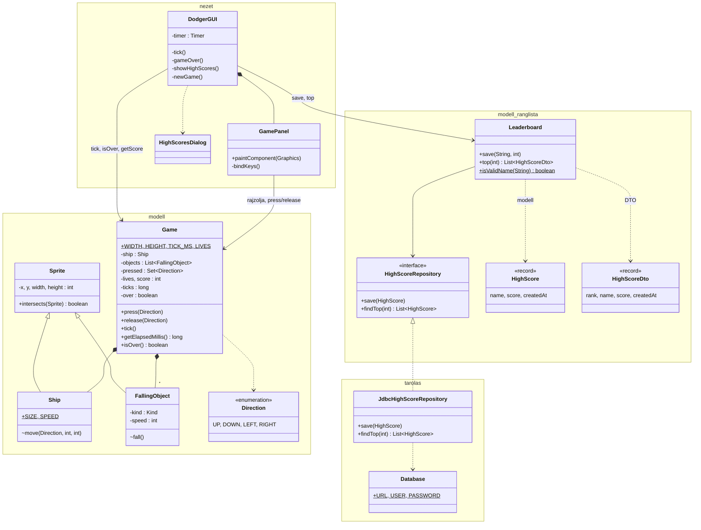
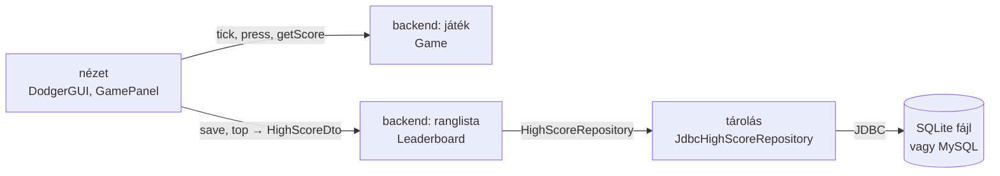
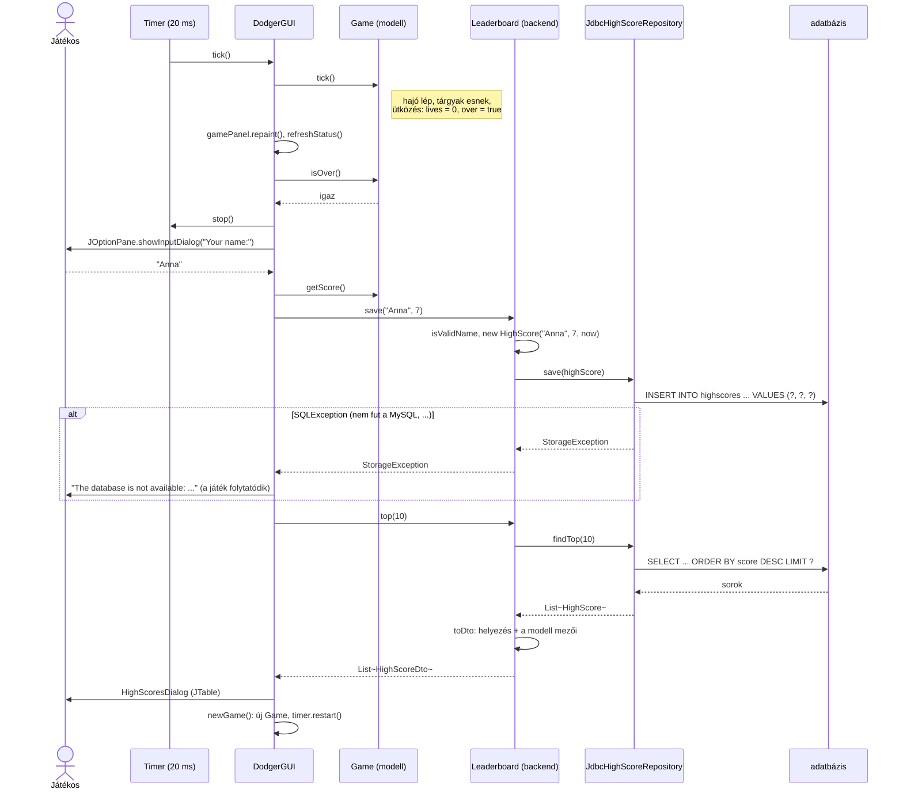

# 11. hét – Adatbázis a játékban: frontend és backend, ranglista, SQL injection; billentyűzet és sprite-ok

A 10. héten egy konzolos programmal néztük meg, hogyan ír és olvas egy Java-program egy adatbázist. Ezen a héten ugyanezt **játékokba** tesszük be, úgy, ahogy a **3. beadandóban** kell: a játék végén egy felugró ablak bekéri a nevet, az eredmény az adatbázisba kerül, egy menüpont a 10 legjobbat mutatja, és bármikor új játék indítható. Közben megnézzük, hova kerül az adatbázis a modell–nézet szerkezetben, mi történik, ha az adatbázis nem érhető el, és mi az az SQL injection. A `Dodger` példa egyben a 3. beadandó többi elemét is megmutatja: **elemi grafikával rajzolt sprite-ok, WASD-irányítás, időzítő**.

## Áttekintés

| Mappa            | Típus   | Téma                                                                                                                                 |
| ---------------- | ------- | ------------------------------------------------------------------------------------------------------------------------------------ |
| `Dodger`         | Példa   | **Sprite-játék** elemi grafikával: WASD-dal irányított hajó, hulló aszteroidák és csillagok, életek, időzítő; a játék végén név bekérése, mentés, **ranglista** adatbázisból; 35 JUnit teszt |
| `ColorclickerDB` | Feladat | A 8. heti optimalizált Color clicker **+ ranglista**: hogyan kerül adatbázis egy kész MV-programba; a legjobb idők táblaméretenként; 38 JUnit teszt |

Mindkét projektben **SQLite az alapértelmezett** (nem kell hozzá semmi), és egy kommentcserével a Dockerben futó **MySQL**-re váltható (`Database.java`; a konténer indítása: a 10. heti README és a projektek `compose.yaml` fájlja). A kód a kettő között nem változik.

---

## Dodger – a játék

Az űrhajót a W/A/S/D billentyűkkel mozgatjuk (a nyilak is jók). A menü gyorsbillentyűi Windowson és Linuxon Ctrl, macOS-en Cmd. Felülről aszteroidák (szürke körök) és csillagok (sárgák) hullanak, egyre sűrűbben. Egy csillag elkapása 1 pont; egy aszteroida 1 életbe kerül. 3 élettel indulunk; amikor elfogy, vége: a program bekéri a nevet, elmenti a pontszámot, megmutatja a 10 legjobbat, és új játékot kezd.

```
┌ Dodger ─────────────────────────────────────────────────────────┐
│ Game                                                            │  ← menü: New game (Ctrl+N), High scores (Ctrl+H), Exit (Ctrl+Q)
├─────────────────────────────────────────────────────────────────┤
│ Score: 7       Lives: 2       Time: 0:42                        │  ← állapotsor: a modellből frissül minden ütemben
├─────────────────────────────────────────────────────────────────┤
│          ●                    ★                                 │
│                                          ●                      │  ← a játéktér (GamePanel, 600 × 400):
│    ★                                                            │     elemi grafika, 50 ütem / mp
│                        ●                                        │
│                                   ★                             │
│                                                                 │
│                          ▲                                      │  ← a hajó: WASD
└─────────────────────────────────────────────────────────────────┘
```

### Felépítés

A projekt három csomagra oszlik; ez a 3. beadandóhoz javasolt szerkezet:

```
src/main/java/dodger/
├── Dodger.java                 belépési pont
├── model/                      BACKEND (modell) – nincs benne Swing, AWT, SQL
│   ├── Direction.java          a négy irány (dx, dy)
│   ├── Sprite.java             egy alakzat: befoglaló téglalap, intersects
│   ├── Ship.java               a hajó: lép, de a játéktéren belül marad
│   ├── FallingObject.java      aszteroida vagy csillag: esik
│   ├── Game.java               a játék: tick, press/release, életek, pont, idő, szabályok
│   ├── Leaderboard.java        a ranglista backendje: save, top; név-ellenőrzés; modell -> DTO (a 10. hétről)
│   ├── HighScore.java          a modell: egy eredmény, ahogy a backend és a tároló kezeli (rekord)
│   ├── HighScoreDto.java       a DTO: egy sor, ahogy a nézet kapja, a helyezéssel (rekord)
│   ├── HighScoreRepository.java  interfész: amit a backend a tárolástól elvár
│   └── StorageException.java   a tárolás hibája
├── db/                         TÁROLÁS – az egyetlen hely, ahol SQL van (a 10. hétről)
│   ├── Database.java           a kapcsolat adatai (SQLite / MySQL)
│   └── JdbcHighScoreRepository.java  a HighScoreRepository JDBC-vel; code-first; PreparedStatement
└── view/                       NÉZET – Swing; csak a backendet (model) hívja, a db csomagot nem látja
    ├── GamePanel.java          paintComponent: a modell kirajzolása; key binding: WASD → press/release
    ├── HighScoresDialog.java   a ranglista táblázata (JTable) DTO-kból
    └── DodgerGUI.java          az ablak, a menü, az állapotsor, a Timer; a játék vége: név, mentés, ranglista, új játék
src/test/java/dodger/
├── model/GameTest.java         15 teszt a játék szabályaira
├── model/LeaderboardTest.java  11 teszt a ranglista backendjére, memóriabeli tárolóval
└── db/JdbcHighScoreRepositoryTest.java  9 teszt a tárolóra (ideiglenes SQLite-fájlon)
```



### Hova kerül az adatbázis az MV-ben?

**A nézet csak a backendet hívja, a backend fedi el az adatbázist.** A backend (a `model` csomag) két részből áll: a játék (`Game`) és a ranglista (`Leaderboard`). A nézet (`DodgerGUI`) a játék végén a `Leaderboard.save`-et, a menüből a `Leaderboard.top`-ot hívja, és DTO-kat (`HighScoreDto`) kap: a modellt (`HighScore`, a tábla egy sora) a backend magának tartja meg, és a felületnek azt adja, amire a megjelenítéshez szükség van, a helyezéssel együtt (ld. a 10. hét: modell és DTO). Hogy a ranglista hol van (SQLite-fájl, MySQL, memória), azt a nézet nem tudja, és nem is érdekli: a `db` csomagot nem importálja.

A `Leaderboard` sem tud SQL-ről: egy `HighScoreRepository` interfészen keresztül tárol, amit a programban a `JdbcHighScoreRepository` valósít meg (a 10. hét tárolója, változatlanul). A `Game` és a `Leaderboard` egymást sem ismeri: a nézet köti össze őket a játék végén (`game.getScore()` → `leaderboard.save`).



Ez azért jó, mert a játék tesztjei (`GameTest`) és a ranglista backendjének tesztjei (`LeaderboardTest`) adatbázis nélkül futnak, a tároló tesztjei (`JdbcHighScoreRepositoryTest`) játék nélkül; és ha egyszer az adatbázist cseréljük, sem a játékhoz, sem a nézethez nem kell nyúlni. A rétegeket a `main` (`Dodger`) köti össze: `new DodgerGUI(new Leaderboard(new JdbcHighScoreRepository()))`.

### Frontend és backend

Amit eddig modellnek és nézetnek hívtunk, az a nagyobb rendszerekben **backend** és **frontend**. A frontend az, amit a felhasználó lát és kezel: itt a Swing-ablak (`view` csomag), egy webes alkalmazásban a böngészőben futó oldal, egy mobilappban a képernyők. A backend az, ami a dolgot csinálja: a szabályok, az adatok, a tárolás (`model` és `db` csomag); webes rendszerben egy szerveren fut, és a frontend hálózaton (pl. REST) beszél vele. A kettő közötti határ ugyanaz, mint nálunk:

| | Frontend (nézet) | Backend (modell + tárolás) |
| --- | --- | --- |
| Mit tud | megjeleníteni, bemenetet fogadni | a szabályokat, az adatokat, a tárolást |
| Mit nem tud | hogy hol és hogyan tárolódik az adat; a szabályokat | hogy milyen a felület (Swing, web, mobil, konzol) |
| Hogyan beszélnek | a frontend a backend **publikus metódusait** hívja (`Game.move`, `Leaderboard.save`), és **DTO**-kat kap; a modellt (`HighScore`) nem látja | a backend soha nem hívja a frontendet (legfeljebb értesít: observer, 6. hét) |
| Csere | a Swing-ablak lecserélhető konzolosra vagy webesre, a backend nem változik | a SQLite lecserélhető MySQL-re, a frontend nem változik |

Ezért fontos, hogy a nézet **ne nyúljon át** a backenden az adatbázisig: ha a `DodgerGUI` maga írna SQL-t, a felület és a tárolás összenőne, és egyiket sem lehetne a másik nélkül cserélni vagy tesztelni. A backenden belül ugyanez az elv ismétlődik: a `Leaderboard` (a szabályok) csak egy interfészt (`HighScoreRepository`) ismer, a JDBC-s tároló ennek egy cserélhető megvalósítása. A nagyobb rendszerek ugyanígy épülnek, csak több lépcsővel: a szabályok középen, kifelé interfészek ("portok"), a külső dolgok (adatbázis, fájl, hálózat) cserélhető "adapterek", és a program beállítás nélkül, értelmes alapértelmezésekkel (SQLite, saját tábla) induljon el. Erről bővebben, ipari környezetben: [Micromonoliths](https://laszlonemes.com/blog/micromonoliths).

### A játék vége – a kulcsszekvencia



A `DodgerGUI.gameOver` kódja ugyanezt mondja:

```java
private void gameOver() {
    String name = askName();                 // null, ha a játékos a Cancel-t választja
    if (name != null) {
        try {
            leaderboard.save(name, game.getScore());
        } catch (StorageException e) {
            showDatabaseError(e);            // üzenet, de a program nem áll le
        }
    }
    showHighScores();
    newGame();
}
```

### Ha nincs adatbázis

A tároló a `SQLException`-t `StorageException`-né csomagolja (ellenőrzött kivétel, a `model` csomagban: a nézet így nem függ a `java.sql`-től); a backend továbbdobja, a nézet elkapja, egy üzenetet mutat (`showDatabaseError`), majd **megy tovább**. Ha nem fut a MySQL-konténer, a játék attól még játszható, csak a mentés és a ranglista nem működik. Ez a helyes viselkedés: egy mellékfunkció hibája ne döntse össze a programot. Próbáljuk ki: állítsuk át a `Database.java`-t MySQL-re úgy, hogy a konténer nem fut, és nézzük meg a játék végét.

Az üzenet a kivétel szövegét is mutatja (`e.getMessage()`): ebből látszik, mi a baj (nem fut a szerver, rossz jelszó, nincs ilyen adatbázis; ld. a 10. heti README hibatáblázatát).

### SQL injection

Tegyük fel, hogy a nevet szövegösszefűzéssel tesszük az SQL-be:

```java
// ROSSZ: így SOHA
String sql = "INSERT INTO highscores (name, score) VALUES ('" + name + "', " + score + ")";
statement.executeUpdate(sql);
```

Ha a játékos a nevének ezt írja be:

```
Robert'); DELETE FROM highscores; --
```

akkor az adatbázis ezt kapja, és **két utasításként** érti:

```sql
INSERT INTO highscores (name, score) VALUES ('Robert'); DELETE FROM highscores; --', 7)
```

A ranglista eltűnt. Egy lekérdezésnél ugyanígy: a `WHERE name = '" + name + "'"` a `x' OR '1'='1` névvel minden sort visszaad. Ez az **SQL injection**: a felhasználó bemenete SQL-kódként fut le. Webes alkalmazásoknál ez a leggyakoribb és legsúlyosabb hibák egyike (adatlopás, adattörlés), és a védekezés egyszerű:

```java
// JÓ: PreparedStatement, a bemenet a ? helyére ADATKÉNT kerül
PreparedStatement statement = connection.prepareStatement(
        "INSERT INTO highscores (name, score, created_at) VALUES (?, ?, ?)");
statement.setString(1, name);     // a név akkor is csak egy szöveg, ha SQL van benne
```

A `PreparedStatement` az SQL szerkezetét (mely utasítás, mely oszlopok) és az adatokat **külön** küldi az adatbázisnak; az adat soha nem válik az utasítás részévé. A `JdbcHighScoreRepositoryTest.nameWithSqlInItIsStoredAsPlainText` tesztje pontosan ezt ellenőrzi: a fenti "név" egy (fura) szövegként kerül a táblába, a tábla megmarad.

A szabály: **minden, ami a felhasználótól (vagy fájlból, hálózatról) jön, `?`-rel kerül az SQL-be.** Az SQL szövege a kódban konstans (`private static final String INSERT = ...`), nincs benne összefűzés. (Oszlop- vagy táblanevet nem lehet `?`-rel megadni; ha az változna, az csak a kód által ismert értékek közül jöhet, pl. egy `enum`-ból.)

### Bemenet-ellenőrzés: nem ugyanaz

A backend (`Leaderboard.save`) a nevet le is vágja (`strip`), és elutasítja, ha üres vagy 50 karakternél hosszabb (`IllegalArgumentException`). Ez **nem** az injection elleni védelem (az a `PreparedStatement` a tárolóban), hanem közönséges ellenőrzés: üres nevet nem akarunk a ranglistán, és a `VARCHAR(50)`-be nem fér több. A nézet (`askName`) ugyanezzel a szabállyal (`Leaderboard.isValidName`) ellenőriz, mielőtt menteni próbálna, és addig kérdez, amíg jó nevet nem kap: a felhasználó értelmes üzenetet lát, nem kivételt. Mindkét helyen ellenőrzünk: a nézet a felhasználóért (értelmes üzenet, azonnal), a backend az adatokért: **a backend ellenőrzése az igazi**, mert a backendet nem csak ez a nézet hívhatja; a nézeté a kényelem, amennyit érdemes (üres név, hossz).

### Billentyűzet: key binding, lenyomás és felengedés

A billentyűzetet nem `KeyListener`-rel, hanem **key bindinggel** kezeljük (`InputMap` + `ActionMap`), két okból: a `KeyListener`-hez a panelnek fókuszban kell lennie (egy menühasználat után elveszik), a key binding `WHEN_IN_FOCUSED_WINDOW` módban akkor is működik, ha a fókusz az ablakon belül bárhol van; és a lenyomás meg a felengedés külön köthető.

```java
getInputMap(JComponent.WHEN_IN_FOCUSED_WINDOW).put(KeyStroke.getKeyStroke("pressed W"), "press-W");
getActionMap().put("press-W", new AbstractAction() {
    public void actionPerformed(ActionEvent e) { game.press(Direction.UP); }
});
getInputMap(JComponent.WHEN_IN_FOCUSED_WINDOW).put(KeyStroke.getKeyStroke("released W"), "release-W");
getActionMap().put("release-W", ...  game.release(Direction.UP) ... );
```

A modell **irányokat** kap (`press(Direction)`, `release(Direction)`), és a `tick` minden lenyomva tartott irányba lépteti a hajót. Így a hajó addig megy, amíg a billentyűt nyomják, és átlósan is tud menni (W + D). A modell billentyűt nem ismer: ha a WASD mellé a nyilakat is bekötjük (mint itt), a modell nem változik.

### Idő: ütemek, nem óra

A `Game` az időt **ütemekben** méri: a `tick` számolja, hányszor hívták, az eltelt idő `ticks × TICK_MS`. Ez a rendszerórától független, ezért a tesztben "eltelik" 1 másodperc, ha 50-szer hívjuk a `tick`-et; a játék vége után nem nő; és ha egy modális ablak miatt a `Timer` áll (ranglista a menüből), az idő is áll. A 8. heti Color clicker az órát használta (`System.currentTimeMillis`), mert ott nem ütemekben halad a játék; egy `Timer`-rel hajtott játékban az ütemszámlálás az egyszerűbb.

### Elemi grafika: a sprite-ok

A modellben egy sprite egy téglalap (`x`, `y`, szélesség, magasság), az ütközés két téglalap metszése (`Sprite.intersects`). A nézet (`GamePanel.paintComponent`) dönti el, hogy ez a téglalap háromszögnek (hajó), körnek (aszteroida) vagy csillagnak látszik: a modell nem tudja. Ha valaki képeket szeretne a formák helyett, a modell nem változik, csak a `draw...` metódusok: `g2.drawImage(image, x, y, width, height, null)`, a képet egyszer betöltve (`ImageIO.read(getClass().getResource("/images/ship.png"))`, a fájl az `src/main/resources/images/` mappában). A 12. heti Arkanoid így csinálja.

### Tesztek

`GameTest` (15): az új játék; a hajó addig megy, amíg az irány le van nyomva; átlós mozgás; a széleken megáll; a tárgyak a sebességükkel esnek, és a játéktér alján eltűnnek; a véletlen játék a játéktéren belül, a megadott sebességgel hoz létre tárgyakat; azonos mag azonos játékot ad; csillag elkapása +1 pont; aszteroida -1 élet; a hajó mellett elhaladó tárgy nem ütközik; az utolsó élet elvesztése vége; a vége után semmi nem történik; az idő ütemekben; a tárgyak listája kívülről nem módosítható.

Két eszköz teszi a véletlent kezelhetővé: a `Game` rögzített magú `Random`-ot kap (`new Random(42)`), vagy egy olyan `Random`-ot, ami soha nem hoz létre tárgyat (`NoSpawn`: a `nextDouble` mindig 1.0), és a csomagszintű `Game.spawn(FallingObject)` metódussal **konkrét tárgyat** teszünk a hajó fölé. Így az "aszteroida eltalálja a hajót" teszt nem a véletlenre vár.

`LeaderboardTest` (11) és `JdbcHighScoreRepositoryTest` (9): ugyanazok, mint a 10. héten.

---

## ColorclickerDB – adatbázis egy kész programba

**Projekt:** `ColorclickerDB`. A 8. heti `ColorclickerOptimized` **változatlan modellel** (`Board`, `Field`, `Position`, és a 19 `BoardTest`), kiegészítve a ranglistával. Ezt kell majd megtenni a saját 2. beadandós (vagy bármelyik) játékkal is: mi változik, ha adatbázist teszünk alá?

| Mi | Hol | Változás |
| --- | --- | --- |
| A modell | `Board`, `Field`, `Position` | **semmi** |
| A ranglista | `Leaderboard`, `HighScore`, `HighScoreDto`, `HighScoreRepository`, `StorageException`, `JdbcHighScoreRepository`, `Database`, `HighScoresDialog` | **új** osztályok (a Dodgerből, a táblához igazítva) |
| A játék vége | `BoardGUI` | a `JOptionPane` helyett egy `Runnable onGameOver` visszahívás, amit a konstruktor kap; a `BoardGUI` nem tud az adatbázisról |
| Név, mentés, ranglista, új játék | `ColorClickerGUI.gameOver` | **új**: ugyanaz a szekvencia, mint a Dodgerben; a `Leaderboard`-ot a `main` adja át |
| Menü | `ColorClickerGUI` | új menüpont: *Game ▸ High scores* (Ctrl+H) |
| A függőségek | `pom.xml` | a két JDBC-driver és a shade plugin |

Itt az eredmény **az idő** (ezredmásodpercben), és a kisebb a jobb; ráadásul csak az azonos méretű táblák eredményei hasonlíthatók össze. Ezért a tábla és a lekérdezés más, mint a Dodgerben:

```sql
CREATE TABLE IF NOT EXISTS results (
    name       VARCHAR(50) NOT NULL,
    size       INTEGER     NOT NULL,     -- 5, 10, 15 vagy 20
    millis     BIGINT      NOT NULL,     -- az idő
    created_at TIMESTAMP   NOT NULL
);

SELECT name, size, millis, created_at FROM results
WHERE size = ?                           -- csak az aktuális méret
ORDER BY millis ASC, created_at ASC      -- a legkisebb idő elöl
LIMIT ?;
```

A tanulság: **a tábla a játékhoz igazodik.** Mi az eredmény (pont, idő, szint)? Mi a jobb (nagyobb, kisebb)? Mi kell még a sorba, hogy a ranglista értelmes legyen (méret, nehézség, pálya)? Ezt kell eldönteni, a tároló és a backend többi része ugyanaz.

---

## Egy fokkal tovább: ami egy "igazi" programban még kellene

A beadandóhoz a fentiek elegendőek. Néhány dolog, amit egy éles alkalmazásban másképp csinálnánk, hogy tudjátok, merre van a következő lépés (és hogy ne csináljátok meg feleslegesen a beadandóban):

- **Kapcsolat-készlet (connection pool).** A tároló minden művelethez új kapcsolatot nyit és zár. Egy asztali játéknál, ahol percenként egyszer kell az adatbázis, ez tökéletes. Egy webes szerver, ami másodpercenként százszor kérdez, egy *pool*-ból (pl. HikariCP) venné a kész kapcsolatokat. A tároló kódja ettől nem változna, csak a `connect()`.
- **Tranzakció.** Ha egy művelet **több SQL-utasításból** áll, és vagy mind, vagy egyik sem szabad, hogy megtörténjen, a `connection.setAutoCommit(false)` ... `commit()` / `rollback()` fogja össze őket. A 3. beadandó 4. feladata (Tron) pont ilyen: "a győztes eredményét növeljük; ha még nincs az adatbázisban, szúrjunk be egy új sort":

  ```java
  // CREATE TABLE IF NOT EXISTS wins (name VARCHAR(50) PRIMARY KEY, wins INTEGER NOT NULL)
  public void addWin(String name) throws SQLException {
      try (Connection connection = connect()) {
          connection.setAutoCommit(false);              // a két utasítás egy egység
          try (PreparedStatement update = connection.prepareStatement(
                  "UPDATE wins SET wins = wins + 1 WHERE name = ?")) {
              update.setString(1, name);
              if (update.executeUpdate() == 0) {          // nem volt ilyen sor: beszúrjuk
                  try (PreparedStatement insert = connection.prepareStatement(
                          "INSERT INTO wins (name, wins) VALUES (?, 1)")) {
                      insert.setString(1, name);
                      insert.executeUpdate();
                  }
              }
              connection.commit();
          } catch (SQLException e) {
              connection.rollback();
              throw e;
          }
      }
  }
  ```

  (Az "upsert"-re mindkét adatbázisnak van saját, egyutasításos írásmódja: SQLite-ban `INSERT ... ON CONFLICT(name) DO UPDATE SET wins = wins + 1`, MySQL-ben `INSERT ... ON DUPLICATE KEY UPDATE wins = wins + 1`. A fenti változat mindkettőben ugyanúgy működik.)
- **Jelszavak a kódban.** A `Database.java`-ban a jelszó a kódban van, ami egy gyakorló projektnél rendben van (a Docker-konténer is ezekkel indul). Éles programban a kapcsolat adatait környezeti változóból vagy konfigurációs fájlból olvassák (`System.getenv("DB_PASSWORD")`), és sosem kerülnek a gitbe.
- **Index.** Ha a tábla nagy (milliós), a `ORDER BY score DESC LIMIT 10`-hez index kell az oszlopra (`CREATE INDEX ... ON highscores (score)`), különben az adatbázis minden sort átnéz. Egy ranglistánál ez nem jön elő.
- **Naplózás.** A `System.err` és a `JOptionPane` helyett egy naplózó könyvtár (`java.util.logging`, SLF4J) írná a hibát fájlba, időbélyeggel.
- **Migráció.** A `CREATE TABLE IF NOT EXISTS` az első verzióhoz jó; ha később egy új oszlop kell, a meglévő táblát módosítani kell (`ALTER TABLE`), és ezt verziózva, sorban futtatni (Flyway, Liquibase). A beadandóban: ha változik a tábla, töröljük a `.db` fájlt (vagy a táblát), és a program újra létrehozza.

Ami **nem** kell: ORM (JPA/Hibernate), külön service-réteg a backend fölé, DTO minden osztályhoz, dependency injection keretrendszer. Egy tábla, egy tároló (`JdbcHighScoreRepository`), egy backend-osztály (`Leaderboard`), egy modell, egy DTO, egy `Database` osztály: ennyi a feladat, és ennyit kell jól megcsinálni.

---

## A 3. beadandó – közös követelmények és tippek

A feladatlap közös követelményei, és hogy a `Dodger`-ben hol vannak megoldva:

| Követelmény | Hogyan |
| --- | --- |
| Felhasználóbarát, könnyen kezelhető | menü gyorsbillentyűkkel; állapotsor (pont, élet, idő); a játék vége egyértelmű; az adatbázis hibája üzenet, nem összeomlás |
| Objektumorientált; a többrétegű felépítés nem kötelező, de ajánlott | `model` / `db` / `view` csomagok; a modell tesztelhető |
| **Elemi grafika**; a játékos sprite-ja **WASD**-dal mozgatható; egérhez kötött egyéb funkciók lehetnek | `GamePanel.paintComponent` (`fillPolygon`, `fillOval`); key binding a W/A/S/D-re, `press`/`release` |
| Ha nem algoritmus generálja a játékteret: **legalább 10 előre definiált pálya** fájlokban; mindegyik végigjátszható | a Dodger véletlenül generál; a pályafájlokhoz ld. lejjebb és a 12. hetet |
| **Időzítő**, ami a játék kezdete óta eltelt időt mutatja | `Game.getElapsedMillis()` (ütemekből), az állapotsor `Time:` mezője |
| A játék végén felugró ablak, **név, mentés adatbázisba**; menüpont a **10 legjobb**; **új játék** egy másik menüből | `DodgerGUI.gameOver`, `askName`, `Leaderboard.save`; *Game ▸ High scores* (`Leaderboard.top(10)`, `HighScoresDialog`); *Game ▸ New game* |
| Dokumentáció: a feladat leírása, elemzése, a program szerkezete **UML osztálydiagrammal**, **implementációs fejezet** (érdekes algoritmusok, pl. pályagenerálás), esemény–eseménykezelő párosítások; **DOCX vagy PDF** | a 12. heti minta dokumentációja mutatja a felépítést (a mintában Markdown, a beadandóban DOCX/PDF) |

Tippek az egyes feladatokhoz (mi a **modell állapota**, mi egy **ütem**, mikor van **vége**, mi kerül az **adatbázisba**):

| # | Feladat | A modell állapota | Egy ütem / lépés | A vége | Az adatbázisba | Mire figyeljünk |
| --- | --- | --- | --- | --- | --- | --- |
| 1 | Maci Laci | a pálya rácsa (fal, kosár, üres), Maci helye, a vadőrök helye és iránya, életek, kosarak száma, pályaszám | a vadőrök lépnek és a falnál fordulnak; a WASD egy mezőt léptet; ütközés: a vadőr látóterében (1 egység) → -1 élet, vissza a bejárathoz | elfogy a 3 élet (a kosarak elfogyása: új pálya) | név + összegyűjtött kosarak | **10 pályafájl**, mindegyik végigjátszható (a bejárattól minden kosár elérhető: BFS-sel ellenőrizhető tesztben); a "látótér" definíciója a modellben, tesztekkel |
| 2 | Kígyó | a kígyó mezői (lista, a fej elöl), az irány, az élelem helye, a kövek, a pont | a fej az irányba lép; élelem: a kígyó nő, új élelem *nem a kígyón*; kő / saját test / szél: vége | ütközés | név + elfogyasztott élelem | az irányváltás a következő ütemben hat (két gyors billentyű ne forduljon vissza önmagába); a véletlen helyet a `Random`-ból, tesztben rögzített maggal |
| 3 | Labirintus | a labirintus rácsa, a játékos és a sárkány helye, a sárkány iránya, teljesített labirintusok száma | a sárkány lép, falnál véletlen új irány; a játékos a WASD-dal; ha a sárkány szomszédos: vége | a sárkány elkapja | név + teljesített labirintusok | **csak 3 sugarú körben látszik** a labirintus: ez a nézet dolga (a modell mindent tud, a `paintComponent` csak a közeli mezőket rajzolja); a játékos és a sárkány ne falon kezdjen; több kijutási út |
| 4 | Tron | két motor helye, iránya és a fénycsíkjuk (a bejárt mezők), a nevek és a színek | mindkét motor lép az irányába; csík vagy szél: a másik nyert | ütközés | a **győztes** sora: `UPDATE ... wins + 1`, vagy `INSERT`, ha még nincs (ld. a tranzakciós példát) | WASD az egyiknek, nyilak a másiknak: két `press`-készlet; a nevek és a színek bekérése a játék elején (`JOptionPane`, `JColorChooser`) |
| 5 | Saját játék | – | – | – | legalább egy tábla, amibe a program ír, és egy szabály szerint visszaolvas | a leírást **a határidő előtt legalább egy héttel** el kell fogadtatni |

### Pályafájlok

Az 1. és a 3. feladatnál (és a sajátnál) a játéktér **fájlból** jön. A legegyszerűbb forma egy szöveges rács, soronként egy sor, karakterenként egy mező:

```
##########
#D....P..#
#.##.###.#
#.#..H...#
#.#.####.#
#P......P#
##########
```

A fájlokat az `src/main/resources/levels/` mappába tesszük (`level01.txt` ... `level10.txt`): a Maven a jar-ba csomagolja őket, és a programból így olvashatók, bárhonnan indítjuk:

```java
try (InputStream in = getClass().getResourceAsStream("/levels/level01.txt");
     BufferedReader reader = new BufferedReader(new InputStreamReader(in, StandardCharsets.UTF_8))) {
    List<String> lines = reader.lines().toList();
    // ... a sorokból rács: lines.get(row).charAt(col)
}
```

A beolvasó legyen **szigorú**: ellenőrizze, hogy minden sor egyforma hosszú, pontosan egy kezdőhely van, van mit gyűjteni; rossz fájlra adjon értelmes hibát. És legyen egy **teszt, ami mind a 10 pályát betölti** és ellenőrzi, hogy végigjátszható (minden gyűjtendő elérhető a kezdőhelyről). A 12. heti minta pontosan ezt csinálja.

---

## Futtatás

A projektekhez **JDK 17 vagy újabb** kell; az első fordításhoz internet (JUnit, a két JDBC-driver).

- **NetBeans:** *File ▸ Open Project* → a projekt mappája → **F6**. Tesztek: **Alt+F6**.
- **IntelliJ IDEA:** *File ▸ Open* → a projekt mappája → *Open as Project* → *Trust Project*; a `.run/` konfiguráció megjelenik, **Shift+F10**. Tesztek: `src/test/java` ▸ *Run 'All Tests'*.
- **Parancssorból** (a projekt mappájából):

  ```
  mvn compile exec:java        # futtatás
  mvn test                     # tesztek (Dodger: 35, ColorclickerDB: 38)
  mvn package                  # target/<projekt>-1.0-SNAPSHOT-all.jar (kövér jar, a driverekkel)
  java -jar target/Dodger-1.0-SNAPSHOT-all.jar
  ```

- **JDK 24+ figyelmeztetés** (`--enable-native-access`): a SQLite-driver natív könyvtára miatt; a futtatási konfigurációk, a tesztek és a kövér jar már a kapcsolóval indulnak, ld. a 10. heti README-t.
- **MySQL-lel:** indítsuk a konténert (a projekt mappájából `docker compose up -d`, vagy a 10. heti README `docker run` parancsa), és a `Database.java`-ban cseréljük a kommenteket. Belenézni: `docker exec -it progtech-mysql mysql -u progtech -p`, majd `USE progtech; SELECT * FROM highscores;`.

A SQLite-fájl (`dodger.db`, `colorclicker.db`) a projekt mappájában jön létre, és nem kerül a gitbe.

## Tippek

- **A nézet csak a backendet hívja.** A `Game` a játék, a `Leaderboard` a ranglista; az adatbázist a `JdbcHighScoreRepository` fedi el, és csak abban van SQL. Ha a nézetben vagy a `Game`-ben `import java.sql` van, valami nem a helyén van.
- **Egy ütem = egy `tick()`.** A `Timer` csak hívja; a hajó mozgása, a tárgyak esése, az ütközések, az új tárgyak, az idő: mind a `tick`-ben. Így a játék tesztelhető: a teszt "nyomja" a billentyűt (`press`) és "várja" az időt (`tick`).
- **Lenyomás és felengedés.** Ha a sprite-nak folyamatosan kell mennie, amíg a billentyűt nyomják, a modell tárolja a lenyomott irányokat (`Set<Direction>`); ha mezőnként lép (rácsos játék), elég a lenyomás.
- **Véletlen a modellben, `Random`-mal**, a tesztnek rögzített mag vagy "néma" `Random`; a biztos tesztekhez egy csomagszintű `spawn`-szerű metódus, amivel a teszt konkrét helyzetet állít elő.
- **A `StorageException`-t a nézet kapja el**, és üzenetet mutat; a program nem áll le. A tároló a `SQLException`-t ebbe csomagolja, nem nyeli el (nem `catch` + `printStackTrace`): a hívó tudja, mit kell tenni.
- **A tábla a játékhoz igazodik:** mi az eredmény, mi a jobb, mi kell még a sorba. A tároló többi része sablon.
- **Nem kell több:** egy tábla, egy tároló, egy backend-osztály, egy modell, egy DTO, `PreparedStatement`, try-with-resources, code-first. Ez a feladat; ezt kell hibátlanul.
