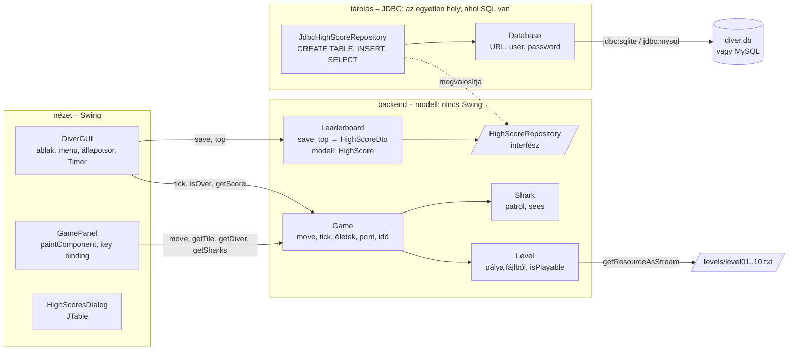
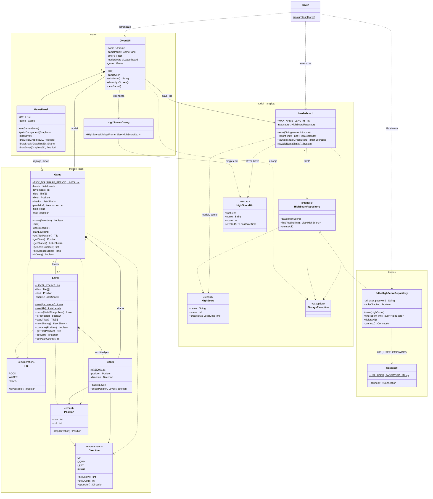
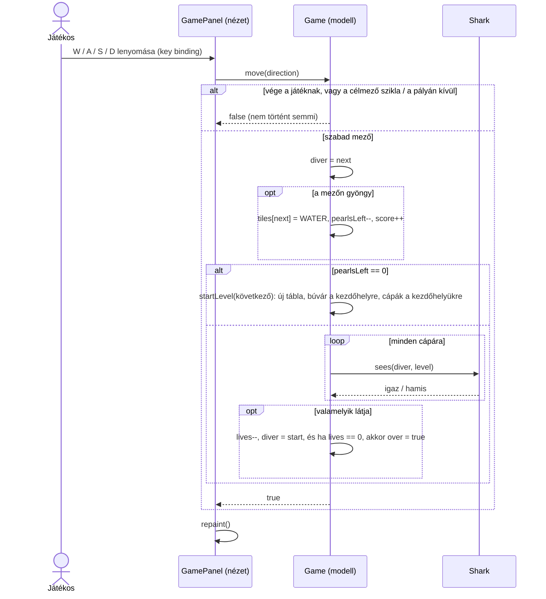
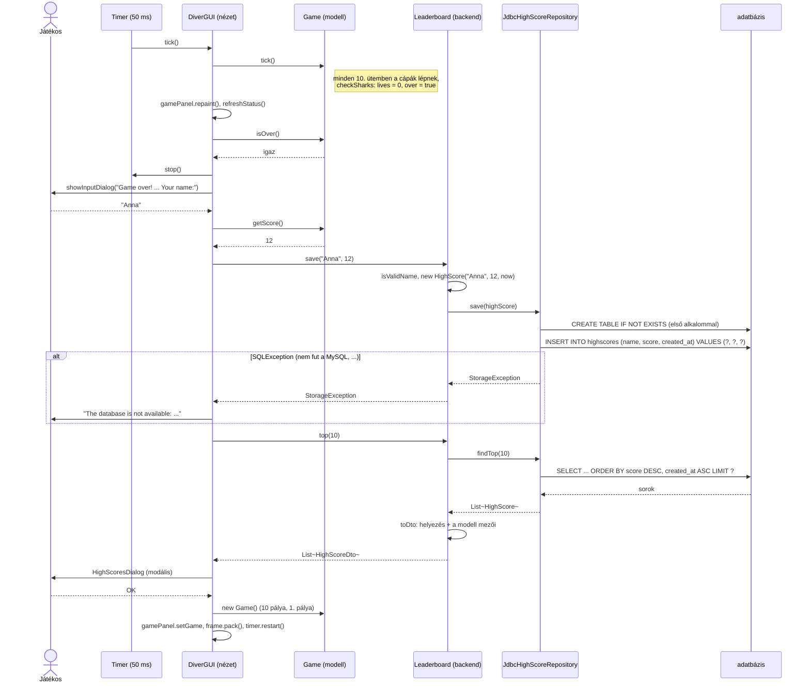
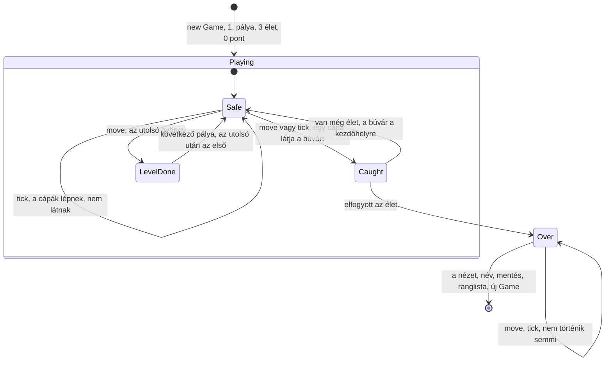

# Gyöngyhalász (Diver) – minta beadandó a 3. feladatsorhoz

Ez a projekt a 3. beadandó **mintamegoldása**: nem a feladatlap egyik feladata (azok ki vannak osztva), hanem egy **hasonló szerkezetű saját játék**, ugyanazokkal a követelményekkel: elemi grafika, WASD, előre definiált pályák fájlokban, időzítő, életek, járőröző ellenfelek, a játék végén név és mentés adatbázisba, a 10 legjobb egy menüből, új játék egy másik menüből. A dokumentáció azt mutatja, mit kell egy beadandó leírásának tartalmaznia; a kód azt, hogyan érdemes felépíteni.

> **A beadandó dokumentációját DOCX vagy PDF formátumban kell leadni.** Ez a leírás csak azért Markdown, mert a repó a GitHubon így olvasható. A fejezetei (1–6.) azok, amiket a saját dokumentációtokba is bele kell tenni; a diagramokat bármilyen eszközzel elkészíthetitek, képként.

```
src/main/java/diver/            a program
src/main/resources/levels/      a 10 pálya (level01.txt ... level10.txt)
src/test/java/diver/            53 JUnit teszt
uml/                            a diagramok külön is (.mmd forrás, .svg, .png)
compose.yaml                    a MySQL-konténer leírása (opcionális)
```

## 1. A feladat

### 1.1 A feladat leírása

Egy búvár gyöngyöket gyűjt egy sziklás, víz alatti barlangban. A barlang egy rács, amelynek mezői szikla (nem járható) vagy víz; néhány vízmezőn gyöngy van. A búvár a hajónál (a pálya kezdőhelyén) indul, és a **W/A/S/D** billentyűkkel (vagy a nyilakkal) egy-egy mezőt lép a négy irányba; sziklára és a pályán kívülre nem léphet. Ha gyöngyös mezőre lép, felveszi a gyöngyöt: ez 1 pont.

A barlangban **cápák** járőröznek: mindegyik egy egyenes mentén, **vízszintesen vagy függőlegesen**, és ha sziklába vagy a pálya szélébe ütközik, megfordul. A cápa **látja** a saját mezőjét és az előtte lévő mezőt (az irányában, 1 egység távolságig), sziklán át nem. Ha a búvár egy cápa látóterébe kerül, **elveszít egy életet**, és visszakerül a hajóhoz. 3 élettel indul.

Ha a búvár a pálya **minden gyöngyét** összegyűjtötte, a következő pálya jön; **10 előre elkészített pálya** van, fájlokban, és mind végigjátszható. A 10. után újra az 1. következik, a pontszám és az életek megmaradnak. Az ablak mutatja a pálya sorszámát, a hátralévő gyöngyöket, az életeket, a pontszámot és a **játék kezdete óta eltelt időt**.

Ha elfogy a 3 élet, **vége a játéknak**: egy felugró ablak bekéri a játékos nevét, és a program az eredményt (a nevet és az összegyűjtött gyöngyök számát) **adatbázisba** menti. Egy menüpontból megtekinthető a **10 legjobb** eredmény a játékosok nevével és pontszámával; egy másik menüpontból bármikor **új játék** indítható.

### 1.2 Elemzés – a szabályok

| # | Szabály | Hol van megvalósítva |
| --- | --- | --- |
| 1 | A pálya rács; a mezők: szikla, víz, gyöngy; a kezdőhely és a cápák kezdőhelye a pályafájlban | `Tile`, `Level.parse` |
| 2 | A pálya fájlból jön; 10 pálya; a fájl szigorúan ellenőrizve (egyforma sorok, pontosan egy kezdőhely, van gyöngy, ismert jelek) | `Level.load`, `Level.parse` |
| 3 | Minden pálya végigjátszható: minden gyöngy elérhető a kezdőhelyről | `Level.isPlayable` (BFS), `LevelTest.allBuiltInLevelsLoadAndArePlayable` |
| 4 | A búvár egy mezőt lép a négy irányba; sziklára és a pályán kívülre nem | `Game.move` |
| 5 | Gyöngyre lépve felveszi: +1 pont, a mező víz lesz | `Game.move` |
| 6 | A cápa az irányába lép minden `SHARK_PERIOD`-ik ütemben; sziklánál és a szélen megfordul (és abban az ütemben nem lép) | `Shark.patrol`, `Game.tick` |
| 7 | A cápa látja a saját mezőjét és az előtte lévő `VISION` = 1 mezőt; sziklán át nem | `Shark.sees` |
| 8 | Ha a búvár egy cápa látóterében van (lépés vagy cápalépés után): -1 élet, vissza a kezdőhelyre | `Game.checkSharks` |
| 9 | 0 élet: vége; utána a `move` és a `tick` nem csinál semmit | `Game.move`, `Game.tick`, `Game.isOver` |
| 10 | Az utolsó gyöngy után a következő pálya; az utolsó után az első; a pont és az élet marad | `Game.move` → `startLevel` |
| 11 | Az idő a játék kezdetétől, ütemekben; a vége után nem nő | `Game.getElapsedMillis` |
| 12 | A játék végén név, mentés; a 10 legjobb; új játék | `DiverGUI.gameOver`, `Leaderboard`, `JdbcHighScoreRepository` |

Két dolgot érdemes külön eldönteni, mert a feladatlap nyitva hagyja:

- **Mi az "egység"?** A rács egy mezője. A cápa a saját mezőjét és az előtte lévő egyet látja (`Shark.VISION = 1`); ez egy konstans, nagyobb látótér egy szám átírása (a teszteknek is).
- **Mikor ellenőrizzük az elkapást?** Minden búvárlépés után és minden cápalépés után; a két esemény között nem történik semmi, így nincs más időpont, amikor változhatna. A kezdőhelyre visszakerült búvárt nem kapjuk el azonnal újra (a pályák úgy készülnek, hogy a kezdőhely cápától távol legyen; a `LevelTest` ellenőrzi, hogy induláskor egy cápa sem látja).

### 1.3 Felhasználói felület

```
┌ Diver ──────────────────────────────────────────────────────────────┐
│ Game                                                                │  ← menü: New game (Ctrl+N), High scores (Ctrl+H), Exit (Ctrl+Q)
├─────────────────────────────────────────────────────────────────────┤
│ Level: 1/10   Pearls left: 3   Lives: 3   Score: 1   Time: 0:12     │  ← állapotsor: a modellből frissül minden ütemben
├─────────────────────────────────────────────────────────────────────┤
│ ▓▓▓▓▓▓▓▓▓▓▓▓                                                        │
│ ▓☺ · · · · · · · · · ▓                                              │  ← a búvár (sárga kör)
│ ▓ · ▓▓▓ · ▓▓▓ · · ▓                                                 │  ← szikla: barna; víz: kék (sakktábla)
│ ▓ · ▓ ○ · · · · ○ ▓ · ▓                                             │  ← gyöngy: fehér kör
│ ▓ · ▓ · ▓▓▓▓ · ▓ · ▓                                                │
│ ▓ · ○ · · ►▒ · · · ○ · ▓                                            │  ← cápa: szürke háromszög az irányába;
│ ▓ · · · · · · · · · · ▓                                             │     a látótere halvány piros
│ ▓▓▓▓▓▓▓▓▓▓▓▓                                                        │
└─────────────────────────────────────────────────────────────────────┘
```

A játék végén két felugró ablak: a név bekérése (*Game over! You collected 7 pearls in 1:02. Your name:*), majd a ranglista (táblázat: #, Name, Pearls, Date). A *Game ▸ High scores* ugyanezt a táblázatot mutatja bármikor; közben a játék áll.

## 2. A program szerkezete

### 2.1 Rétegek: frontend és backend

A program három csomagból áll, és a függőségek egy irányba mutatnak: a nézet a backendet ismeri, a backend a nézetet nem; a tárolás a backend interfészét valósítja meg.



| Réteg | Csomag | Mit tud | Mit nem tud |
| --- | --- | --- | --- |
| **nézet** (frontend) | `diver.view` | rajzol, billentyűt és menüt kezel, a backendet hívja, DTO-kat jelenít meg | a szabályokat; hogy hol és hogyan tárolódik a ranglista (a `db` csomagot nem importálja) |
| **backend** (modell) | `diver.model` | a játék szabályai (`Game`, `Level`, `Shark`), a ranglista szabályai (`Leaderboard`), a ranglista modellje (`HighScore`) és a nézetnek szánt DTO (`HighScoreDto`), a tárolás elvárt felülete (`HighScoreRepository`) | hogy Swing vagy konzol a felület; hogy SQLite vagy MySQL a tároló; nincs benne `javax.swing`, `java.awt`, `java.sql` |
| **tárolás** | `diver.db` | SQL, JDBC, a kapcsolat adatai | a játékot; a felületet |

A rétegeket a `main` (`Diver`) köti össze: `new DiverGUI(new Leaderboard(new JdbcHighScoreRepository()))`.

### 2.2 Fájlok

```
src/main/java/diver/
├── Diver.java                      belépési pont: összeköti a rétegeket
├── model/                          BACKEND – nincs benne Swing, AWT, SQL
│   ├── Direction.java              a négy irány (dRow, dCol), opposite
│   ├── Position.java               sor, oszlop (rekord), step(Direction)
│   ├── Tile.java                   ROCK, WATER, PEARL
│   ├── Level.java                  egy pálya kiinduló állapota: parse, load, isPlayable
│   ├── Shark.java                  egy cápa: patrol, sees
│   ├── Game.java                   a játék: move, tick, életek, pont, idő, pályaváltás
│   ├── Leaderboard.java            a ranglista backendje: save, top; név-ellenőrzés; modell -> DTO
│   ├── HighScore.java              a modell: egy eredmény, ahogy a backend és a tároló kezeli (rekord)
│   ├── HighScoreDto.java           a DTO: egy sor, ahogy a nézet kapja, a helyezéssel (rekord)
│   ├── HighScoreRepository.java    interfész: amit a backend a tárolástól elvár
│   └── StorageException.java       a tárolás hibája
├── db/                             TÁROLÁS
│   ├── Database.java               a kapcsolat adatai: SQLite (alap) / MySQL (kikommentezve)
│   └── JdbcHighScoreRepository.java  a HighScoreRepository JDBC-vel; code-first; PreparedStatement
└── view/                           NÉZET – Swing
    ├── GamePanel.java              paintComponent: a pálya rajzolása; key binding: WASD → Game.move
    ├── HighScoresDialog.java       a ranglista táblázata (JTable) DTO-kból
    └── DiverGUI.java               az ablak, a menü, az állapotsor, a Timer; a játék vége
src/main/resources/levels/level01.txt ... level10.txt
src/test/java/diver/
├── model/LevelTest.java            12 teszt: a pálya beolvasása, ellenőrzése, a 10 pálya
├── model/GameTest.java             21 teszt: a játék szabályai kis pályákon
├── model/LeaderboardTest.java      11 teszt: a ranglista backendje memóriabeli tárolóval
└── db/JdbcHighScoreRepositoryTest.java  9 teszt: a tároló ideiglenes SQLite-fájlon
```

### 2.3 UML osztálydiagram



A diagram forrása és képként: [`uml/2-osztalydiagram.mmd`](uml/2-osztalydiagram.mmd), [`.svg`](uml/2-osztalydiagram.svg), [`.png`](uml/2-osztalydiagram.png). A mintában Mermaid-szöveggel készült, de ez nem követelmény: a saját dokumentációba bármilyen eszközzel rajzolt osztálydiagram jó, képként beillesztve.

### 2.4 Az osztályok és a metódusok

#### `Direction` (enum), `Position` (record), `Tile` (enum)

A rács alapfogalmai. A `Direction` az elmozdulást adja (`dRow`, `dCol`) és az ellentétét (`opposite`, a cápa fordulásához); a `Position.step(direction)` a szomszédos mező; a `Tile.isPassable()` mondja meg, rá lehet-e lépni (csak a szikla nem).

#### `Level` – egy pálya kiinduló állapota

| Művelet | Mit csinál |
| --- | --- |
| `load(number)`, `loadAll()` | a beépített pályák az `src/main/resources/levels` mappából (a jar belsejéből, `getResourceAsStream`) |
| `parse(lines)` | pálya a szöveges sorokból; a `D`, `H`, `V` jelekből a kezdőhely és a cápák, alattuk víz; **szigorú**: egyforma sorhossz, pontosan egy `D`, legalább egy `P`, ismert jelek; a hibaüzenet megmondja a sort |
| `isPlayable()` | minden gyöngy elérhető-e a kezdőhelyről (szélességi bejárás, ld. 3.1) |
| `copyTiles()`, `newSharks()` | a `Game` ezekkel kap **saját másolatot**: a `Level` nem változik a játék közben, ezért akárhányszor újrakezdhető |
| `contains`, `getTile`, `getStart`, `getSharks`, `getPearlCount`, `getRows`, `getCols` | lekérdezések |

#### `Shark` – egy cápa

| Művelet | Mit csinál |
| --- | --- |
| `patrol(level)` | egy lépés az irányba, ha a következő mező szabad; különben megfordul, és nem lép (csomagszintű: csak a `Game` hívja) |
| `sees(target, level)` | a saját mezője, vagy az előtte lévő legfeljebb `VISION` mező az irányában; szikla és a pálya széle megállítja |

#### `Game` – a játék

| Művelet / lekérdezés | Mit csinál |
| --- | --- |
| `Game()`, `Game(levels)` | új játék a 10 beépített pályával, vagy tetszőleges pályákkal (a tesztek kis, szövegként megadott pályákat adnak) |
| `move(direction)` | a búvár lépése: szikla / szél → nem történik semmi (`false`); gyöngy → +1 pont; utolsó gyöngy → következő pálya; különben elkapás-ellenőrzés |
| `tick()` | egy ütem: az idő telik; minden `SHARK_PERIOD`-ik ütemben a cápák lépnek, majd elkapás-ellenőrzés |
| `checkSharks()` (privát) | ha valamelyik cápa látja a búvárt: -1 élet, vissza a kezdőhelyre; 0 élet → vége |
| `getTile(position)`, `getDiver()`, `getSharks()`, `getLevelNumber()`, `getLevelCount()`, `getPearlsLeft()`, `getLives()`, `getScore()`, `getElapsedMillis()`, `isOver()` | lekérdezések; a nézet ezekből rajzol és ír |

#### `Leaderboard`, `HighScore`, `HighScoreDto`, `HighScoreRepository`, `StorageException` – a ranglista backendje

| Osztály | Feladat |
| --- | --- |
| `Leaderboard` | `save(name, score)`: a név ellenőrzése (`isValidName`: szóközök nélkül 1..50 karakter), a modell elkészítése a mostani idővel, mentés a tárolóba; `top(limit)`: a legjobbak a tárolóból, **modellből DTO-vá alakítva** (`toDto`), a helyezéssel |
| `HighScore` | a **modell**: rekord (`name`, `score`, `createdAt`), a tábla egy sora; a backend és a tároló dolgozik vele, a nézet nem látja |
| `HighScoreDto` | a **DTO**: rekord (`rank`, `name`, `score`, `createdAt`); amit a nézet kap, a megjelenítéshez szükséges adatokkal (a helyezést a modell nem tárolja, a backend számolja) |
| `HighScoreRepository` | interfész: `save(HighScore)`, `findTop(limit)`, `deleteAll()`; a backend ezen keresztül tárol, és nem tudja, mi van mögötte |
| `StorageException` | ellenőrzött kivétel: a tárolás nem sikerült; a nézet ezt kapja el |

#### `JdbcHighScoreRepository`, `Database` – a tárolás

A `HighScoreRepository` megvalósítása JDBC-vel: **az egyetlen osztály, amiben SQL van.** Code-first (`CREATE TABLE IF NOT EXISTS` az első kapcsolatnál), minden művelet saját kapcsolattal (try-with-resources), minden érték `PreparedStatement` `?`-ével, a `SQLException` `StorageException`-né csomagolva. A `Database` a kapcsolat adatai: SQLite alapból (`diver.db` a projekt mappájában), a MySQL-sorok kikommentezve (a 10. heti README írja le a Docker-konténert).

#### `DiverGUI`, `GamePanel`, `HighScoresDialog` – a nézet

| Osztály | Feladat |
| --- | --- |
| `DiverGUI` | az ablak, a menü, az állapotsor, a `Timer` (`TICK_MS` = 50 ms): minden ütemben `game.tick()`, `repaint`, állapotsor; pályaváltáskor `pack()`; a játék végén `gameOver()`: név, `leaderboard.save`, ranglista, `newGame()` |
| `GamePanel` | `paintComponent`: mezőnként `CELL` × `CELL` képpont; szikla, víz, gyöngy, a cápák (háromszög az irányukba, a látóterük halvány piros), a búvár; **key binding** W/A/S/D (és a nyilak) → `game.move(direction)` |
| `HighScoresDialog` | modális ablak egy `JTable`-lel a DTO-kból; nem tud az adatbázisról |

### 2.5 Tervezési döntések

- **A `Level` változatlan, a `Game` másolaton dolgozik.** A felvett gyöngy a `Game` saját `tiles` tömbjében lesz víz, a `Level`-ben marad; a cápákból is új példányok készülnek. Így ugyanaz a `Level` újra és újra indítható, és a 10 pálya egyszer töltődik be.
- **A búvár mezőnként lép, a cápák ütemre.** A búvár lépése a billentyű lenyomása (`move`), a cápáké az idő (`tick`, minden tizedik ütemben). A kettő a modellben találkozik: mindkettő után `checkSharks`.
- **Az idő ütemekben.** `getElapsedMillis() = ticks × TICK_MS`: a tesztben "eltelik" az idő, ha hívjuk a `tick`-et; a modális ablakok alatt (a `Timer` áll) az idő is áll.
- **A látótér konstans** (`Shark.VISION`), és a nézet ki is rajzolja: a játékos látja, hova nem szabad lépni. A nézet ugyanazt a szabályt rajzolja, amit a `Shark.sees` számol; ha a szabály változik, mindkettőt frissíteni kell (ezt a tesztek és a rajz együtt dokumentálják).
- **A nézet csak a backendet hívja.** A `view` csomag a `db` csomagot nem importálja; a `Leaderboard` DTO-kat ad (a `HighScore` modellt a nézet nem látja); a `StorageException` a `model` csomagban van, hogy a nézet ne függjön a `java.sql`-től.
- **A tároló interfész.** A `Leaderboard` adatbázis nélkül tesztelhető (`LeaderboardTest` memóriabeli tárolóval); a SQLite/MySQL csere csak a `Database` három sora.
- **A véletlen nincs a játékban.** A pályák előre adottak, a cápák determinisztikusan járőröznek: a játék teljesen kiszámítható, ezért minden teszt pontos állapotot vár. (A feladatlap más feladatainál – véletlen pálya, véletlen irányt választó sárkány – a `Random`-ot a konstruktor kapja, rögzített maggal tesztelve, mint a 8. heti Color clickerben.)

## 3. Implementáció – az érdekesebb részek

### 3.1 A pálya betöltése és a végigjátszhatóság ellenőrzése

A pálya egy szöveges rács az `src/main/resources/levels/levelNN.txt` fájlokban:

```
############
#D.........#
#.###.###..#
#.#P....P#.#
#.#.####.#.#
#.P..H...P.#
#..........#
############
```

| Jel | Jelentése |
| --- | --- |
| `#` | szikla |
| `.` | víz |
| `P` | gyöngy |
| `D` | a búvár kezdőhelye (a hajó); alatta víz |
| `H` | vízszintesen járőröző cápa, jobbra indul; alatta víz |
| `V` | függőlegesen járőröző cápa, lefelé indul; alatta víz |

A fájlokat a Maven a jar-ba csomagolja, és a program a `getResourceAsStream("/levels/level01.txt")` hívással olvassa: így bárhonnan indítva megtalálja őket (nem a munkakönyvtártól függ, mint az Arkanoid `data/` mappája). A `Level.parse` soronként és karakterenként megy végig a szövegen, és **minden hibát azonnal, a sor számával jelez**: nem egyforma sorhossz, ismeretlen jel, hiányzó vagy több kezdőhely, nincs gyöngy. Egy rossz pályafájl így a fejlesztés közben derül ki, nem a játékos gépén.

A feladatlap előírja, hogy minden pálya végigjátszható legyen. Ezt nem "ránézésre" tudjuk, hanem a program ellenőrzi: a `Level.isPlayable()` a kezdőhelyről **szélességi bejárással** (BFS) végigjárja a sziklán át nem vezető utakat, és megnézi, hogy minden gyöngy a bejárt mezők között van-e.

```java
public boolean isPlayable() {
    Set<Position> visited = new HashSet<>();
    Queue<Position> queue = new ArrayDeque<>();
    queue.add(start);
    visited.add(start);
    while (!queue.isEmpty()) {
        Position current = queue.remove();
        for (Direction direction : Direction.values()) {
            Position next = current.step(direction);
            if (contains(next) && getTile(next).isPassable() && visited.add(next)) {
                queue.add(next);
            }
        }
    }
    // minden gyöngy a visited halmazban van?
    ...
}
```

A `LevelTest.allBuiltInLevelsLoadAndArePlayable` tesztje mind a 10 pályát betölti, és ellenőrzi, hogy van gyöngy, van cápa, végigjátszható, és induláskor egy cápa sem látja a kezdőhelyet. Ha valaki elront egy pályafájlt, a teszt szól.

### 3.2 A cápák: járőrözés és látótér

A cápa állapota két adat: a helye és az iránya. A járőrözés egy lépés, és a fordulás egy ütemet "elvesz": a cápa a falnál megáll, megfordul, és a következő ütemben indul vissza. Ez egyszerű, és a játékosnak is látszik.

```java
void patrol(Level level) {
    Position next = position.step(direction);
    if (level.contains(next) && level.getTile(next).isPassable()) {
        position = next;
    } else {
        direction = direction.opposite();
    }
}
```

A látótér: a cápa a saját mezőjét látja, és előre `VISION` mezőt az irányában; sziklánál és a pálya szélénél a nézés megáll. A `sees` ezt a mezőnként haladó ciklussal számolja, ezért a `VISION` értéke szabadon növelhető:

```java
boolean sees(Position target, Level level) {
    if (position.equals(target)) {
        return true;
    }
    Position ahead = position;
    for (int distance = 1; distance <= VISION; distance++) {
        ahead = ahead.step(direction);
        if (!level.contains(ahead) || !level.getTile(ahead).isPassable()) {
            return false;                 // szikla vagy a pálya széle: nem lát tovább
        }
        if (ahead.equals(target)) {
            return true;
        }
    }
    return false;
}
```

A cápák átúsznak a gyöngyök fölött (a gyöngy marad), és egymáson is: két cápa egy mezőn nem hiba.

### 3.3 Ütemezés: lépés, ütem, idő

A játéknak két "órája" van. A **búvár** akkor lép, amikor a játékos billentyűt nyom (`move`): ez nem függ az időtől. A **cápák** az időre lépnek: a nézet `Timer`-e `TICK_MS` = 50 ms-onként hívja a `tick`-et, és minden `SHARK_PERIOD` = 10. ütemben (fél másodpercenként) a cápák egyet lépnek. Mindkét lépés után a `checkSharks` nézi meg, hogy a búvár veszélyben van-e.

Az eltelt idő `ticks × TICK_MS`: nem a rendszeróra, hanem az ütemek száma. Ezért a tesztben az idő "múlik", ha hívjuk a `tick`-et; a játék vége után nem nő; és amíg egy modális ablak nyitva van (a `Timer` áll), az idő is áll.

### 3.4 A ranglista: backend, DTO, tároló

A játék végén a nézet a `Leaderboard.save(name, score)`-t hívja, a menüből a `Leaderboard.top(10)`-et, és `HighScoreDto`-kat kap. A `Leaderboard` a nevet ellenőrzi, a modellt (`HighScore`) a mostani idővel állítja össze, és a `HighScoreRepository` interfészen át tárolja; a lekérdezett modellekből a nézetnek DTO-t készít a helyezéssel (`toDto`). A programban a tárolót a `JdbcHighScoreRepository` valósítja meg:

```sql
CREATE TABLE IF NOT EXISTS highscores (
    name       VARCHAR(50) NOT NULL,
    score      INTEGER     NOT NULL,
    created_at TIMESTAMP   NOT NULL
);
INSERT INTO highscores (name, score, created_at) VALUES (?, ?, ?);
SELECT name, score, created_at FROM highscores ORDER BY score DESC, created_at ASC LIMIT ?;
```

A táblát a program hozza létre (code-first), minden érték `?`-rel kerül az SQL-be (`PreparedStatement`: SQL injection ellen), és a `SQLException` `StorageException`-né csomagolva ér a nézethez, ami üzenetet mutat, és a játék megy tovább. Részletesen: a 10. és a 11. heti README.

## 4. Esemény–eseménykezelő párosítások

| Esemény | Komponens | Eseménykezelő | Tevékenység |
| --- | --- | --- | --- |
| W / A / S / D (és a nyilak) lenyomása | `GamePanel` (key binding, `WHEN_IN_FOCUSED_WINDOW`) | `AbstractAction` a `bindKeys`-ben | `game.move(direction)`, `repaint()` |
| A `Timer` ütése (50 ms) | `DiverGUI.timer` | `tick()` | `game.tick()`; pályaváltáskor `pack()`; `repaint()`; állapotsor; ha vége: `timer.stop()`, `gameOver()` |
| *Game ▸ New game* (Ctrl+N) | `JMenuItem` | `newGame()` | új `Game`, `gamePanel.setGame`, `pack()`, `timer.restart()` |
| *Game ▸ High scores* (Ctrl+H) | `JMenuItem` | `showHighScores()` | `timer.stop()`; `leaderboard.top(10)` → `HighScoresDialog`; `StorageException` → üzenet; `timer.start()` |
| *Game ▸ Exit* (Ctrl+Q) | `JMenuItem` | lambda | `System.exit(0)` |
| A játék vége (a `tick`-ből) | – | `gameOver()` | `askName()` (addig kérdez, amíg a név jó, vagy Cancel); `leaderboard.save`; `showHighScores()`; `newGame()` |
| *OK* a ranglista ablakában | `JButton` (default button) | lambda | `dispose()` |
| Az ablak bezárása | `JFrame` | `EXIT_ON_CLOSE` | kilépés |

## 5. Szekvencia- és állapotdiagramok

### 5.1 Egy lépés



### 5.2 A játék vége



### 5.3 A játék állapotai



A diagramok forrása és képként az [`uml/`](uml/) mappában: `1-retegek`, `2-osztalydiagram`, `3-szekvencia-lepes`, `4-szekvencia-jatek-vege`, `5-allapotok` (`.mmd`, `.svg`, `.png`).

## 6. Tesztek

53 JUnit teszt, négy osztályban; mind Swing nélkül fut, és a játék tesztjei adatbázis nélkül.

| Osztály | Db | Mit ellenőriz |
| --- | --- | --- |
| `LevelTest` | 12 | a beolvasás (mezők, kezdőhely, cápák, a `D`/`H`/`V` alatt víz); a másolatok függetlenek a `Level`-től; a hibás pályák elutasítva, a hibaüzenet a sort mondja (nem egyforma sorok, ismeretlen jel, nincs / több kezdőhely, nincs gyöngy, üres); `isPlayable` igaz és hamis esete; `load` rossz sorszámra; **mind a 10 beépített pálya** betölthető, van benne gyöngy és cápa, végigjátszható, és induláskor egy cápa sem látja a kezdőhelyet |
| `GameTest` | 21 | az új játék; a búvár mozgása (víz, szikla, a pálya széle sziklák nélkül is); a gyöngy felvétele (pont, a `Level` nem változik); az utolsó gyöngy után a következő pálya, az utolsó után az első; a cápák ütemre lépnek, sziklánál és a szélen fordulnak, gyöngy fölött átúsznak; elkapás: a cápa elé lépve, a cápa a búvár mellé lépve; a szikla mögé nem lát, oldalra nem lát; az utolsó élet után vége; a vége után semmi nem történik; az idő ütemekben; a cápák listája kívülről nem módosítható |
| `LeaderboardTest` | 11 | a backend memóriabeli tárolóval: a mentett modell neve le van vágva és a mostani időt kapja; a `top` DTO-kat ad helyezéssel, a legjobbal kezdve; a `toDto` a modell mezőit másolja és a helyezést teszi hozzá; az üres, `null`, túl hosszú név elutasítva és nem kerül a tárolóba; `limit` pozitív; `isValidName` |
| `JdbcHighScoreRepositoryTest` | 9 | a tároló ideiglenes SQLite-fájlon: üres tábla; a mentett modell visszajön; a sorrend; a `LIMIT`; a névbe írt SQL csak szöveg; a törlés; két tároló ugyanazt látja; elérhetetlen szerverre `StorageException` |

A játék tesztjei **kis pályákat szövegként** adnak meg (`Level.parse(List.of("#####", "#D..#", "#.H.#", "#.P.#", "#####"))`): a tesztből azonnal látszik, milyen helyzetet vizsgál, és nem kell hozzá fájl. A cápák lépését a `sharkStep` segédmetódus váltja ki (`SHARK_PERIOD` darab `tick`).

## 7. Futtatás

**JDK 17 vagy újabb** kell; az első fordításhoz internet (JUnit, a két JDBC-driver).

- **NetBeans:** *File ▸ Open Project* → a `Diver` mappa → **F6**. Tesztek: **Alt+F6**. (A menü gyorsbillentyűi Windowson és Linuxon Ctrl, macOS-en Cmd.)
- **IntelliJ IDEA:** *File ▸ Open* → a `Diver` mappa → *Open as Project* → *Trust Project*; a `.run/Diver.run.xml` konfiguráció megjelenik, **Shift+F10**. Tesztek: `src/test/java` ▸ *Run 'All Tests'*.
- **Parancssorból** (a `Diver` mappából):

  ```
  mvn compile exec:java        # futtatás
  mvn test                     # 53 teszt
  mvn package                  # target/Diver-1.0-SNAPSHOT-all.jar (kövér jar: a driverek és a pályák benne)
  java -jar target/Diver-1.0-SNAPSHOT-all.jar
  ```

**Adatbázis.** Alapból SQLite (a JDK 24+ natív-hozzáférés figyelmeztetése ellen a futtatási konfigurációk, a tesztek és a kövér jar a `--enable-native-access=ALL-UNNAMED` kapcsolóval indulnak): a `diver.db` fájl a projekt mappájában jön létre az első mentéskor, semmit nem kell beállítani. MySQL-hez: indítsuk a konténert (`docker compose up -d` a projekt mappájából, vagy a 10. heti README `docker run` parancsa), és a `src/main/java/diver/db/Database.java`-ban cseréljük a kommenteket. A program többi része nem változik. Ha az adatbázis nem érhető el, a játék játszható, a mentésnél és a ranglistánál üzenet jelenik meg.
