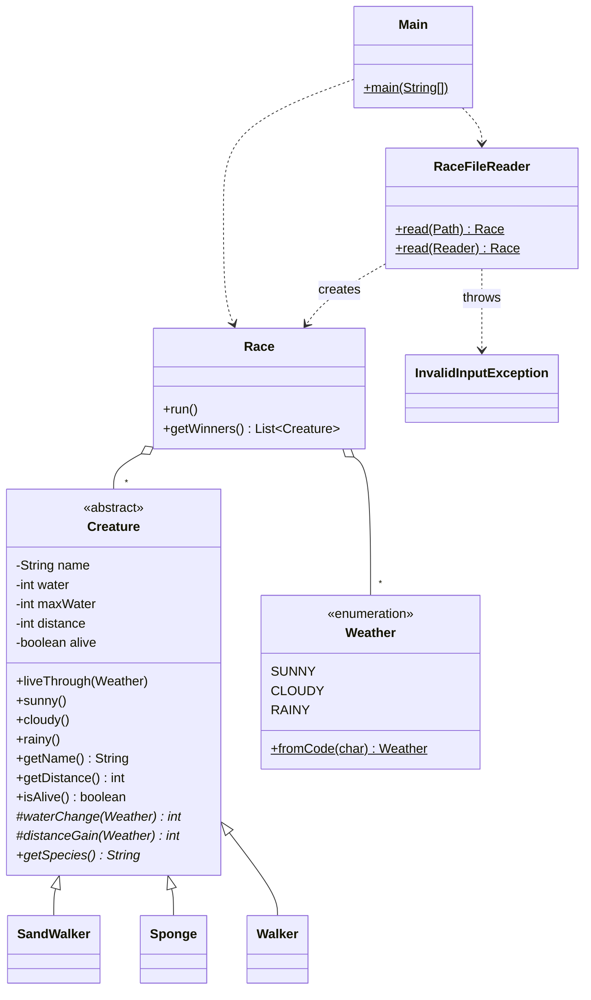

# Race – sample solution of the 1st take-home assignment

A multi-day race of creatures: the program reads the race from a text file, simulates it, and prints the winner – the creature that travels the farthest **while staying alive**.

## The task

Every creature has a unique name, an amount of stored water, a species-specific water capacity, a travelled distance (initially 0) and is either alive or dead.

Each day of the race is sunny, cloudy or rainy. On every day, each living creature

1. first changes its water according to the table below – the water can never exceed the capacity of the species,
2. dies if its water drops to 0, and does nothing from then on,
3. otherwise moves according to the table.

| Species                  | Code | Water: sunny | cloudy | rainy | Distance: sunny | cloudy | rainy | Capacity |
| ------------------------ | ---- | ------------ | ------ | ----- | --------------- | ------ | ----- | -------- |
| sand walker (homokjáró)  | `h`  | -1           | 0      | +3    | 3               | 1      | 0     | 8        |
| sponge (szivacs)         | `s`  | -4           | +1     | +6    | 0               | 1      | 3     | 20       |
| walker (lépegető)        | `l`  | -2           | -1     | +3    | 1               | 2      | 1     | 12       |

## Input file

```
4
Vandor h 4
Seta l 7
Csuszo s 12
Siklo s 10
nffeeennf
```

- **Line 1:** the number of creatures (at least 1).
- **One line per creature:** name, species code (`h`, `s`, `l`) and initial water, separated by whitespace.
- **Last line:** the days of the race, one letter per day: `n` sunny (napos), `f` cloudy (felhős), `e` rainy (esős).

Blank lines are ignored. Files are read as UTF-8.

### What counts as invalid input

The program refuses the file, with a message naming the line, when

- the file is empty, or the first line is not a whole number ≥ 1,
- there are fewer or more creature lines than declared,
- a creature line does not consist of exactly three fields,
- the species code is unknown (codes are case-sensitive),
- the initial water is not a whole number, is not positive, or exceeds the capacity of the species,
- two creatures have the same name,
- the line of the days is missing or contains a letter other than `n`, `f`, `e`,
- there is anything after the line of the days.

## Running the program

The project needs **JDK 17 or newer**.

### In NetBeans

Open the `Race` project and press **F6** (Run Project). The program asks for the name of the input file in the Output window; relative names are resolved against the project folder, so the bundled samples can be entered simply as `teszt.txt`.

### From the command line

Compile, then run from the project folder. The file name can be passed as an argument; without it the program asks for it.

```
javac -encoding UTF-8 -d build/classes src/race/*.java
java -cp build/classes race.Main teszt2.txt
```

```
The race lasted 9 day(s).

Final standings:
  Vandor (sand walker): distance 17, water 4/8, alive
  Seta (walker): distance 11, water 1/12, alive
  Csuszo (sponge): distance 8, water 4/20, alive

Winner: Vandor (distance: 17)
```

Results are written to the standard output, errors to the standard error. The exit code is `0` on success and `1` if the file could not be read or was invalid.

### Bundled sample files

| File                | Result                                                                  |
| ------------------- | ----------------------------------------------------------------------- |
| `teszt.txt`         | The sample of the assignment: all four creatures tie at distance 12     |
| `teszt2.txt`        | Single winner: Vandor, distance 17                                      |
| `teszt3.txt`        | No winner: the only creature dies on the 4th day                        |
| `teszt_invalid.txt` | Error: `Line 3: Unknown species code: x`                                |

If several living creatures share the largest distance, all of them are listed as winners. If nobody survives, there is no winner.

## Running the tests

The tests are JUnit 4 tests in the `test` folder. JUnit 4 and Hamcrest come from the libraries bundled with NetBeans, nothing has to be downloaded.

- **NetBeans:** press **Alt+F6** (Test Project), or right-click a test class → *Test File*. The results appear in the *Test Results* window.
- **Command line, with Ant:** run `ant test` in the project folder. If Ant is not installed separately, the one shipped with NetBeans can be used (`<NetBeans>/extide/ant/bin/ant`). Outside the IDE Ant also has to be told where NetBeans keeps its library definitions:

  ```
  ant -Duser.properties.file=%APPDATA%\NetBeans\<version>\build.properties test
  ```

| Test class           | What it covers                                                                          |
| -------------------- | --------------------------------------------------------------------------------------- |
| `WeatherTest`        | Mapping of the day codes                                                                |
| `CreatureTest`       | Constructor checks, the table of each species, water cap, death, no move on the day of death |
| `RaceTest`           | Running the race, single winner, tie, no survivor, dead creatures cannot win            |
| `RaceFileReaderTest` | Parsing valid files and every kind of invalid input listed above                        |
| `MainTest`           | The whole program: output, asking for the file name, error messages and exit codes      |

The API documentation can be generated in NetBeans with *Run → Generate Javadoc*, or with `ant javadoc`; it is written to `dist/javadoc`.

## Design



| Class                   | Responsibility                                                                                   |
| ----------------------- | ------------------------------------------------------------------------------------------------ |
| `Creature`              | Abstract base class. Implements the rules of a day once; the species only supply the numbers.    |
| `SandWalker`, `Sponge`, `Walker` | The three species: water change, distance and capacity from the table.                  |
| `Weather`               | The three kinds of days and their codes in the file.                                             |
| `Race`                  | Stores the creatures and the days in collections, runs the race, selects the winners.            |
| `RaceFileReader`        | Reads and validates the input line by line, creates the creatures by their species code.         |
| `InvalidInputException` | Checked exception for invalid input, with a message fit for the user.                            |
| `Main`                  | Command line interface: gets the file name, prints the result, handles the exceptions.           |
