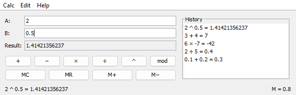
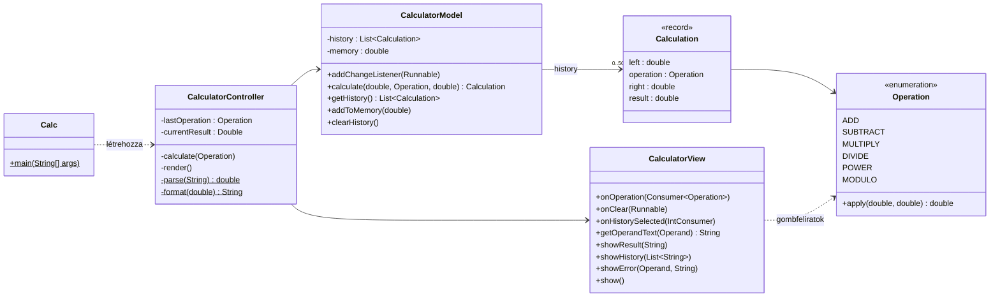

# Számológép MVC-ben

**Projekt:** `calcMVC` (Maven)

A `calc` példa számológépe, modell–nézet–vezérlő (MVC) szerkezetben újraírva és néhány funkcióval kibővítve. A cél, hogy jól látsszon, **mi melyik rétegbe kerül, és hogyan beszélnek egymással a rétegek** – ezért a modell szándékosan egyszerű.



## Funkciók

| Funkció          | Leírás                                                                                         |
| ---------------- | ---------------------------------------------------------------------------------------------- |
| Műveletek        | `+`, `−`, `×`, `÷`, `^` (hatvány), `mod` (maradék)                                             |
| Hibakezelés      | felugró ablak helyett az állapotsorban, piros betűvel; a hibás mező megjelölve, fókuszban      |
| Előzmények       | a legutóbbi 50 számolás; dupla kattintás vagy Enter visszatölti a mezőkbe                       |
| Memória          | `MC`, `MR`, `M+`, `M−`; az állapotsor jobb oldalán `M = ...` mutatja, ha nem üres              |
| Enter            | az operandusmezőkben megismétli az utoljára használt műveletet                                 |
| Szerkesztés menü | eredmény másolása a vágólapra, eredmény átvétele A-ba, A és B cseréje, törlés, előzmények törlése |
| Billentyűzet     | gyorsbillentyűk a menüpontokhoz (Windowson Ctrl, macOS-en Cmd), `Alt+A` / `Alt+B` / `Alt+R` a mezőkre ugrik |
| Kiírás           | 12 értékes jegyre kerekítve: `0.1 + 0.2` eredménye `0.3` (és nem `0.30000000000000004`)        |

## Felépítés

```
src/main/java/calc/
├── Calc.java                       belépési pont: létrehozza és összeköti a három réteget
├── model/                          MODELL – nem használ Swinget
│   ├── Operation.java              a műveletek (enum) és a számolás szabályai
│   ├── Calculation.java            egy elvégzett számolás (record)
│   └── CalculatorModel.java        számolás, előzmények, memória, változásjelzés
├── view/
│   └── CalculatorView.java         NÉZET – a felület felépítése és megjelenítés
└── controller/
    └── CalculatorController.java   VEZÉRLŐ – események -> modell, modell -> nézet
src/test/java/calc/model/           a modell JUnit tesztjei
```



### Ki miért felel?

- **Modell** (`calc.model`): a számolás szabályai és az állapot (előzmények, memória). Nem tud a felületről, semmilyen Swing osztályt nem használ – ezért a teszt egyszerűen meghívja a metódusait, nem kell hozzá ablak. Ha az állapota megváltozik, értesíti a feliratkozókat (`addChangeListener`), de azt nem tudja, kik azok.
- **Nézet** (`calc.view`): felépíti a felületet, és megjeleníti, amit kap – csak szövegeket. A gombjait nem adja ki; ehelyett `onXxx(...)` metódusokkal lehet feliratkozni az eseményeire. Így a vezérlő nem függ attól, hogy egy funkció gomb, menüpont vagy billentyűparancs a felületen.
- **Vezérlő** (`calc.controller`): összeköti a kettőt. Beolvassa a nézetből a szövegeket, számmá alakítja őket, meghívja a modellt, kezeli a hibákat, és a modell változásakor frissíti a nézetet. Itt van a csak a felülethez tartozó állapot is: az utoljára használt művelet (az Enterhez) és a kijelzett eredmény.

### Hova kerül a számolás? – a modellbe, nem a vezérlőbe

Gyakori kérdés, hogy ha a vezérlő "irányít", nem ott kellene-e számolni. **Nem:** a számolás szabályai (mit jelent a `mod`, mi történik nullával osztáskor) a program lényege, ezért a modellbe valók. A vezérlő csak közvetít:

```java
// VEZÉRLŐ – nem számol, csak beolvas, továbbít és megjelenít
double left = parse(view.getOperandText(Operand.A));       // szöveg -> szám
double right = parse(view.getOperandText(Operand.B));
Calculation calculation = model.calculate(left, operation, right);   // a modell számol
view.showResult(format(calculation.result()));             // szám -> szöveg
```

Ha a számolás a vezérlőben (vagy a nézet eseménykezelőjében) lenne:

- a szabályokat csak a felülettel együtt lehetne kipróbálni, JUnit-tal nem;
- egy másik felület (pl. webes vagy parancssoros változat) nem tudná újrahasználni őket, újra kellene írni;
- a vezérlő egyre hízna, és végül ugyanaz a "minden egy osztályban" kód lenne, amit el akartunk kerülni.

Ökölszabály: **ha egy kód akkor is kellene, ha holnap lecserélnénk a felületet, az a modellbe való.** A szöveg ↔ szám átalakítás (`parse`, `format`) azért van mégis a vezérlőben, mert az a felülethez tartozik: egy parancssoros változat másképp olvasná be és írná ki a számokat.

### Egy számolás útja

```
Felhasználó        CalculatorView           CalculatorController              CalculatorModel
    │  "×" gomb          │                           │                               │
    ├───────────────────>│  onOperation(MULTIPLY)    │                               │
    │                    ├──────────────────────────>│                               │
    │                    │  getOperandText(A), (B)   │                               │
    │                    │<──────────────────────────┤  parse(...)                   │
    │                    │                           │  calculate(6, MULTIPLY, 7)    │
    │                    │                           ├──────────────────────────────>│
    │                    │                           │      értesítés (listener)     │
    │                    │  showHistory([...])       │<──────────────────────────────┤
    │                    │<──────────────────────────┤  render()                     │
    │                    │  showResult("42")         │                               │
    │                    │<──────────────────────────┤                               │
```

Ha a szöveg nem szám, a `parse` kivételt dob, és a vezérlő a `showError(...)` metódussal jelzi a hibát; a modellhez el sem jut a kérés.

## Lambda és metódusreferencia – mit jelent a `this::`?

A nézet nem tudja, mit kell csinálni egy gomb megnyomásakor, ezért a vezérlő **egy darab kódot ad át neki**, amit a nézet majd az eseménykor lefuttat. Ezt kétféleképpen írhatjuk le:

```java
view.onClear(() -> clear());          // lambda: "ha megnyomják, hívd meg a clear()-t"
view.onClear(this::clear);            // metódusreferencia: ugyanez rövidebben
```

A `this::clear` tehát **nem hívja meg** a `clear` metódust, csak megmondja, melyik metódust kell majd meghívni. A `::` előtt az áll, *kinek* a metódusa:

| Írásmód               | Jelentése                                           | Ugyanez lambdával                 |
| --------------------- | --------------------------------------------------- | --------------------------------- |
| `this::clear`         | ennek az objektumnak (a vezérlőnek) a `clear` metódusa | `() -> clear()`                |
| `this::calculate`     | a vezérlő `calculate` metódusa, a kapott művelettel | `operation -> calculate(operation)` |
| `model::clearHistory` | a modell `clearHistory` metódusa                    | `() -> model.clearHistory()`      |
| `view::close`         | a nézet `close` metódusa                            | `() -> view.close()`              |

Lambdát akkor írunk, ha a hívandó kódnak más paraméter kell, vagy több utasításból áll, pl. `() -> calculate(lastOperation)`.

A paraméter típusa azt mondja meg, milyen adatot kap az átadott kód. Ezek a Java beépített *funkcionális interfészei* (egyetlen metódusuk van, ezért írható helyettük lambda):

| Típus                 | Az átadott kód kap... | Hol használjuk                                       |
| --------------------- | --------------------- | ---------------------------------------------------- |
| `Runnable`            | semmit                | a legtöbb menüpont és gomb, a modell változásjelzése |
| `Consumer<Operation>` | egy műveletet         | `onOperation`: melyik műveleti gombot nyomták meg    |
| `IntConsumer`         | egy `int` értéket     | `onHistorySelected`: hányadik előzményt választották |

Ugyanezt csináljuk a `button.addActionListener(e -> ...)` hívásnál is, ott az `ActionListener` a funkcionális interfész.

## Esemény – eseménykezelő párosítások

A gyorsbillentyűknél a Ctrl macOS-en Cmd.

| Esemény                                       | Eseménykezelő (vezérlő)   | Tevékenység                                                                 |
| --------------------------------------------- | ------------------------- | --------------------------------------------------------------------------- |
| műveleti gomb (`+ − × ÷ ^ mod`)               | `calculate(op)`           | beolvas, a modellel számoltat, kiírja az eredményt; hiba esetén hibaüzenet  |
| Enter az A vagy B mezőben                     | `calculate(lastOperation)`| megismétli az utoljára használt műveletet                                   |
| *Edit → Copy result* (Ctrl+Shift+C)           | `copyResult()`            | az eredményt a vágólapra másolja                                            |
| *Edit → Use result as A* (Ctrl+R)             | `useResult()`             | az eredményt átírja A-ba, B-t törli – a műveletek láncolhatók                |
| *Edit → Swap A and B* (Ctrl+Shift+S)          | `swapOperands()`          | felcseréli a két operandust                                                 |
| *Edit → Clear* (Ctrl+L)                       | `clear()`                 | törli a mezőket                                                             |
| *Edit → Clear history* (Ctrl+Shift+L)         | `model.clearHistory()`    | törli az előzményeket                                                       |
| dupla kattintás / Enter az előzményekben      | `loadFromHistory(index)`  | visszatölti a számolást a mezőkbe                                           |
| `MC` / `MR`                                   | `model.clearMemory()` / `recallMemory()` | kinullázza a memóriát / beírja az utoljára használt mezőbe   |
| `M+` / `M−`                                   | `addResultToMemory()` / `subtractResultFromMemory()` | hozzáadja az eredményt a memóriához / kivonja belőle |
| *Calc → Exit* (Ctrl+Q), az ablak bezárása     | `view.close()`            | bezárja az ablakot, a program leáll                                        |
| *Help → About*                                | (a nézet maga kezeli)     | névjegy – csak a felületet érinti, ezért nem megy a vezérlőhöz              |
| a modell megváltozott                         | `render()`                | újrarajzolja az előzményeket és a memória kijelzését                        |

## Futtatás és tesztelés

A projekthez **JDK 17 vagy újabb** szükséges. A projekt **Maven** projekt: a `pom.xml` írja le a függőségeket (JUnit) és a build lépéseit, így NetBeans nélkül, bármilyen fejlesztőkörnyezetben vagy parancssorból is ugyanúgy fordítható.

A program Windowson és macOS-en (és Linuxon) is ugyanúgy indul; a menük gyorsbillentyűi Windowson a **Ctrl**, macOS-en a **Cmd** billentyűvel működnek.

- **NetBeans:** *File → Open Project*, és válasszuk ki a `calcMVC` mappát (a NetBeans felismeri a `pom.xml` alapján). Futtatás: **F6**, tesztek: **Alt+F6** (macOS-en **Ctrl+F6**). Az első buildnél a Maven letölti a szükséges csomagokat, ehhez internet kell.

  A futtatás beállítása a projekt `nbactions.xml` fájljában van: ez mondja meg a NetBeansnek, hogy a `calc.Calc` osztályt indítsa. Enélkül a NetBeans maga próbálja kitalálni a főosztályt, és ha ez nem sikerül, a *Could not find or load main class ${packageClassName}* hibával áll le.
- **Parancssorból** (a `calcMVC` mappából). Ha nincs külön telepített Maven, a NetBeans sajátja is használható:
  - Windows: `"C:\Program Files\Apache NetBeans\java\maven\bin\mvn.cmd"`
  - macOS: `"/Applications/Apache NetBeans.app/Contents/Resources/netbeans/java/maven/bin/mvn"`

  ```
  mvn compile exec:java                       fordítás és futtatás
  mvn test                                    csak a tesztek
  mvn package                                 fordítás, tesztek, futtatható jar készítése
  java -jar target/calcMVC-1.0-SNAPSHOT.jar   a kész jar futtatása
  ```

A tesztek (`src/test/java/calc/model`) a modellt ellenőrzik – ablak nélkül, mert a modell nem használ Swinget:

| Tesztosztály          | Mit ellenőriz                                                                       |
| --------------------- | ----------------------------------------------------------------------------------- |
| `OperationTest`       | minden művelet, negatív és törtkitevő, nullával osztás, nem véges eredmény           |
| `CalculatorModelTest` | előzmények sorrendje és korlátja, hibás számolás nem kerül be, memória, változásjelzések |

## Néhány döntés indoklása

- **Hibaüzenet az állapotsorban.** A felugró ablakot minden elírás után le kell okézni, ez zavaró. A hiba helye (a megjelölt mező) azonnal látszik.
- **Nem módosítható adatok.** A `Calculation` record, a `getHistory()` másolatot ad: a modell állapota kívülről csak a metódusain keresztül változhat.
- **Az ablak csak a bekötés után jelenik meg.** A `Calc` előbb létrehozza a modellt, a nézetet és a vezérlőt, és csak a végén hívja a `view.show()` metódust.
- **A bezárás a vezérlőn megy keresztül** (`DO_NOTHING_ON_CLOSE` + `onExit`). Most csak bezár, de itt lehetne pl. rákérdezni a mentésre.
- **`double` és kerekített kiírás.** Egy számológéphez ez elég. Pénzügyi számításnál a `BigDecimal` típust használnánk, ami tízes számrendszerben, pontosan számol.

## Továbbfejlesztési ötletek

- Az előzmények mentése fájlba kilépéskor és visszatöltése indításkor (ld. a 4. heti fájlkezelést).
- A vezérlő tesztelése: a nézet helyére egy tesztben egy "ál-nézet" (*mock*) kerül, ami csak feljegyzi, mit kért tőle a vezérlő. Ehhez a nézetből egy interfészt kell kiemelni.
- Egy parancssoros felület ugyanarra a modellre – jó próba arra, hogy tényleg minden szabály a modellben van-e.
