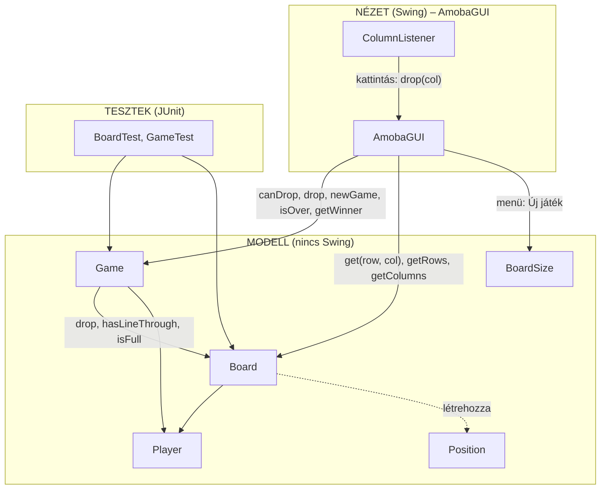
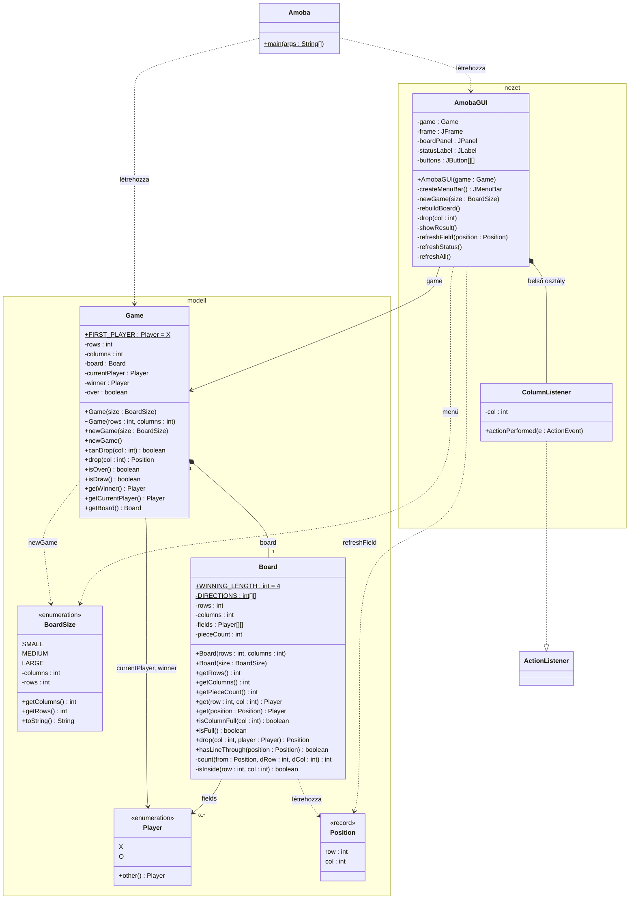
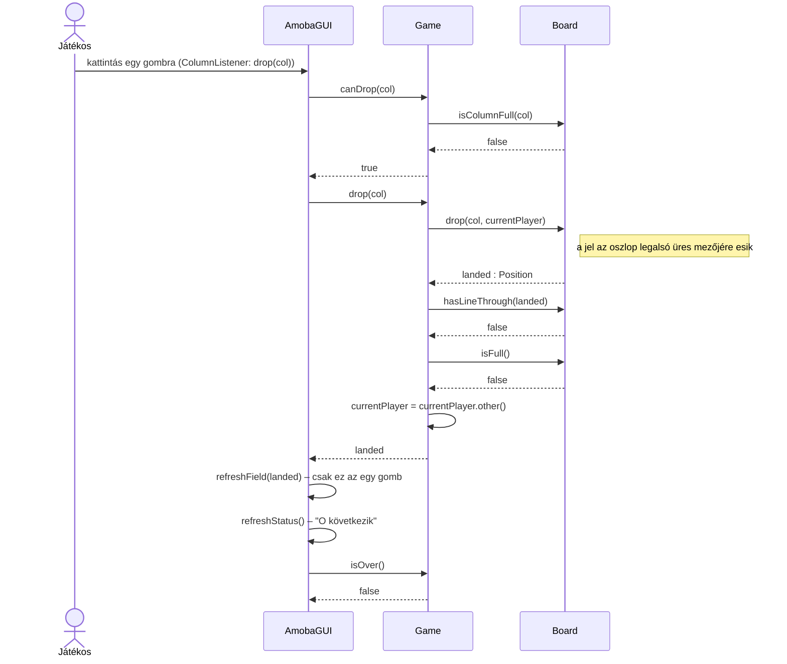
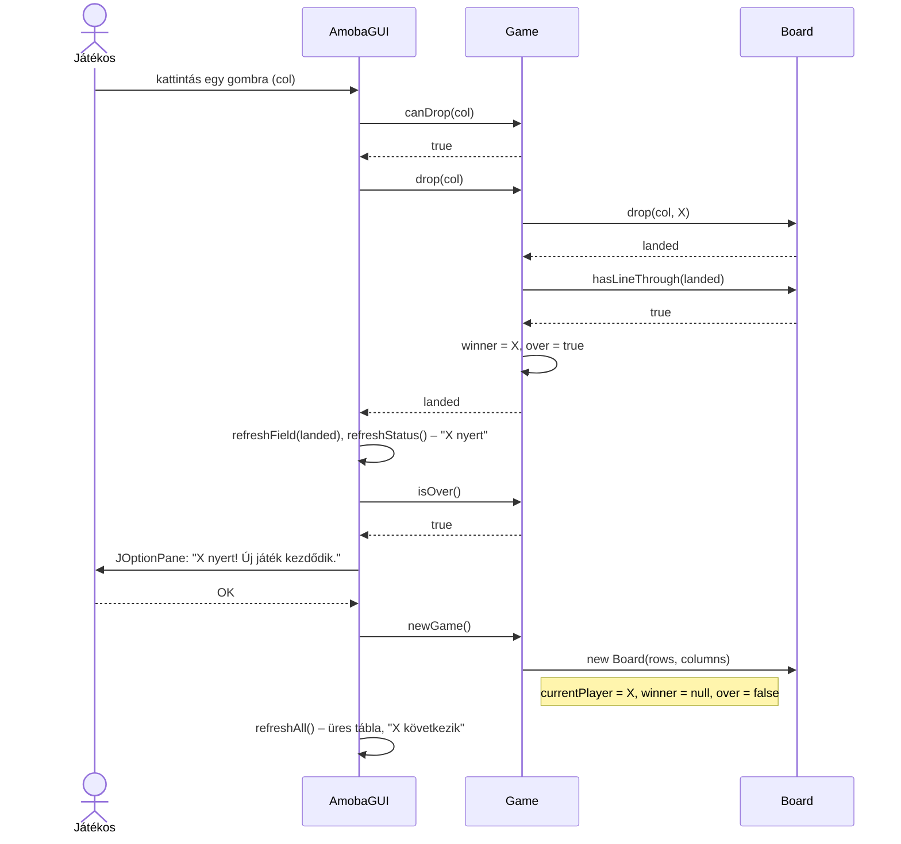
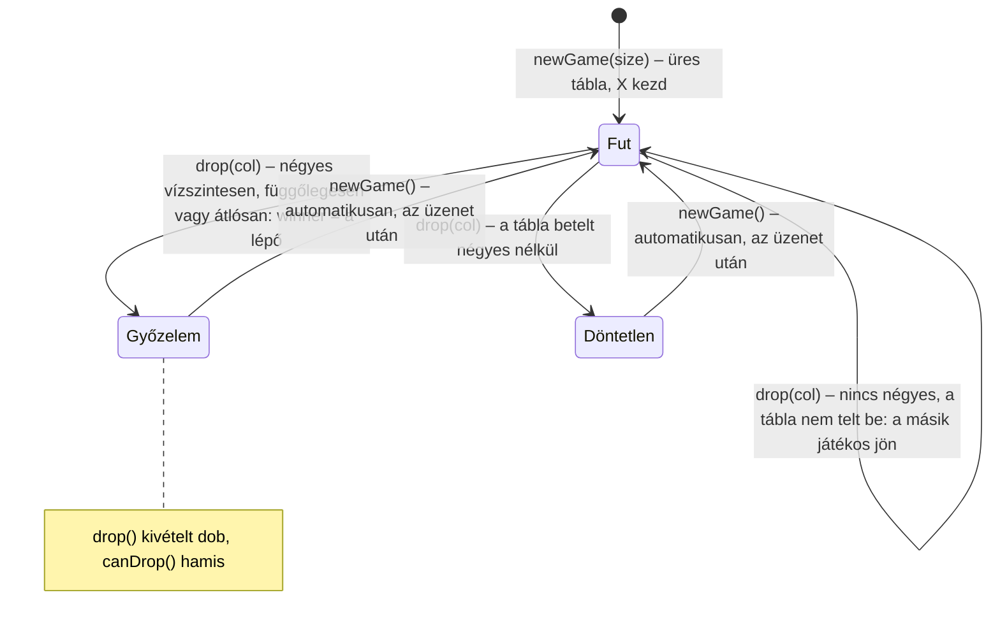

# Potyogós amőba – a 2. beadandó 1. feladatának mintamegoldása

**Projekt:** `Amoba` (Maven, JDK 17 vagy újabb, Swing, JUnit 4)

Kétszemélyes táblás játék. Az X és az O játékos felváltva "potyogtat" jeleket egy n × m-es táblára: a jel a választott oszlop legalsó üres mezőjére esik. Az nyer, aki előbb rak ki négy egymás melletti jelet vízszintesen, függőlegesen vagy átlósan; ha a tábla betelik, döntetlen. A játék végén a program kiírja az eredményt, és automatikusan új játékot kezd.

Ez a projekt azt mutatja meg, hogyan néz ki egy **beadásra kész** megoldás a 2. beadandóhoz:

- a játék szabályai egy Swing nélküli **modellben** vannak (`Board`, `Game`), a felület (`AmobaGUI`) csak megjelenít és továbbít,
- a modellhez **JUnit tesztek** tartoznak (43 teszt, ablak nélkül futnak),
- a dokumentáció tartalmazza a feladat **elemzését**, a program **szerkezetét UML osztálydiagrammal**, az **esemény–eseménykezelő párosításokat** és a tevékenységek leírását, ahogy a feladatlap kéri,
- NetBeansben, IntelliJ IDEA-ban és parancssorból is fordul, fut és tesztelhető.

A 7. heti `FlashcardsMV` és a 8. heti `ColorclickerOptimized` ugyanerre a mintára épül; érdemes azokat is megnézni.

---

## 1. A feladat

> **1. Potyogós amőba.** Készítsünk programot, amellyel a következő két személyes játékot lehet játszani. Adott egy n × m mezőből álló tábla (n az oszlopok, m a sorok száma), amelyre a játékosok X, illetve O jeleket potyogtatnak (azaz egy adott oszlopban a karakter mindig „leesik” a legalsó üres sorba, függetlenül attól, melyik sorban helyeztük le).
>
> A játékosok felváltva lépnek, és egy oszlopban csak akkor helyezhetnek el új jelet, ha az még nem telt meg. A játékot az nyeri, aki előbb elhelyez vízszintesen, vagy átlósan négy szomszédos jelet. A játék döntetlennel ér véget, ha betelik a tábla. A program biztosítson lehetőséget új játék kezdésére a táblaméret megadásával (8×5, 10×6, 12×7), és ismerje fel, ha vége a játéknak. Ekkor jelenítse meg, hogy melyik játékos győzött (ha nem lett döntetlen), majd kezdjen automatikusan új játékot.

### 1.1 Elemzés – a szabályok

A feladat szövegéből ezek a szabályok következnek. Mindegyikhez tartozik egy teszt is (ld. [5. Tesztek](#5-tesztek)).

| # | Szabály | Hol van a kódban |
|---|---------|------------------|
| 1 | A tábla n oszlop × m sor, három méretben: 8×5, 10×6, 12×7. | `BoardSize` enum |
| 2 | Egy mező üres, vagy X-é, vagy O-é. | `Board.fields` (`Player[][]`, `null` az üres) |
| 3 | A két játékos felváltva lép. | `Game.currentPlayer`, `Game.drop` a lépés végén vált |
| 4 | A jel a választott oszlop **legalsó üres** mezőjére esik, mindegy, melyik sorban kattintottunk. | `Board.drop(col, player)` |
| 5 | Tele oszlopba nem lehet lépni. | `Board.isColumnFull`, `Game.canDrop` |
| 6 | Az nyer, aki előbb rak ki **négy** egymás melletti jelet **vízszintesen, függőlegesen vagy átlósan**. | `Board.hasLineThrough`, `Board.DIRECTIONS` |
| 7 | Ha a tábla betelik (és az utolsó lépés nem nyert), döntetlen. | `Board.isFull`, `Game.drop` |
| 8 | A játék vége után nincs több lépés. | `Game.over`, `Game.canDrop` |
| 9 | A játék végén a program kiírja az eredményt, majd automatikusan új játékot kezd. | `AmobaGUI.drop` → `showResult`, `game.newGame()` |
| 10 | Új játék kezdhető a méret megadásával. | `AmobaGUI` menü, `Game.newGame(BoardSize)` |

**Olvassuk el figyelmesen a feladatot, és írjuk le, hogyan értelmeztük!** A feladatlap a 6. szabálynál vízszintes vagy átlós négyest említ. A mintamegoldás a közismert játék (Connect Four) szabályát követi, és a **függőleges négyest is győzelemnek veszi**; ezt a `fourInAColumnWins` teszt dokumentálja. Az irányok egyetlen tömbben vannak (`Board.DIRECTIONS`): ha szigorúan csak a vízszintes és az átlós négyes számítana, onnan kell az `{1, 0}` elemet törölni, és egy tesztet átírni.

**Amit a feladat nem mond ki, és el kellett dönteni** (ezeket a dokumentációban mindig írjuk le):

- Mindig **X kezd**, az új játékot is (`Game.FIRST_PLAYER`).
- Egy oszlop **bármelyik** gombjára kattintva a jel az oszlopba esik (a feladat ezt mondja: "függetlenül attól, melyik sorban helyeztük le").
- Tele oszlopra vagy a játék vége után kattintva **nem történik semmi**, hibaüzenet sincs: a felhasználó látja, hogy az oszlop tele van.
- Ha az **utolsó lépés tölti be a táblát és egyben négyest is ad**, az győzelem, nem döntetlen (`aWinningLastMoveIsAWinNotADraw` teszt).
- A játék végén a **modális üzenetablak** bezárása után indul az új játék, **ugyanakkora** táblán. Amíg az ablak nyitva van, a végállás látszik.
- A gombok nem tiltódnak le a játék végén, mert azonnal új játék jön.

### 1.2 Felhasználói felület

```
┌ Potyogós amőba ─────────────────────────────────────────┐
│ Játék                                                   │  ← menü: Új játék ▸ 8 × 5 / 10 × 6 / 12 × 7, Kilépés (Ctrl+Q)
├─────────────────────────────────────────────────────────┤
│ [   ] [   ] [   ] [   ] [   ] [   ] [   ] [   ]         │  ← 0. sor (a tábla teteje)
│ [   ] [   ] [   ] [   ] [   ] [   ] [   ] [   ]         │
│ [   ] [   ] [ O ] [   ] [   ] [   ] [   ] [   ]         │
│ [   ] [ X ] [ X ] [   ] [   ] [   ] [   ] [   ]         │
│ [ O ] [ O ] [ X ] [ X ] [   ] [   ] [   ] [   ]         │  ← 4. sor (a tábla alja)
├─────────────────────────────────────────────────────────┤
│ Tábla: 8 × 5      O következik                          │  ← állapotsor
└─────────────────────────────────────────────────────────┘
```

- A tábla gombokból áll (`JButton`, `GridLayout`), az X piros, az O kék. Az ablak mérete `pack()`-kel igazodik a táblához, méretváltáskor is.
- Az állapotsor mutatja a tábla méretét, és hogy ki következik.
- A játék végén üzenetablak: *„X nyert! Új játék kezdődik.”* vagy *„Döntetlen! Új játék kezdődik.”*

---

## 2. A program szerkezete

### 2.1 Rétegek: modell és nézet

Két réteg van (**Model-View**), mint a 7. heti `FlashcardsMV`-ben. A függőség egyirányú: a nézet ismeri a modellt, a modell semmit nem tud a nézetről, és nem használ Swinget.



| Réteg  | Osztályok | Feladat | Mit **nem** csinál |
|--------|-----------|---------|--------------------|
| Modell | `Game`, `Board`, `Player`, `BoardSize`, `Position` | a tábla állapota, ki következik, a potyogás, a négyes felismerése, a játék vége, a győztes | nem rajzol, nem nyit ablakot, nem tud gombokról |
| Nézet  | `AmobaGUI` (+ `ColumnListener`) | ablak, menü, gombrács, állapotsor, üzenetablak; az eseménykezelők a modellt hívják, majd frissítik a felületet | nem tárol játékállapotot, nem dönti el, hova esik a jel, ki nyert |
| –      | `Amoba` | belépési pont: létrehozza a modellt és a nézetet az EDT-n | |

Ellenőrzés: a modell osztályaiban **egyetlen `javax.swing` vagy `java.awt` import sincs**. A modell egy parancssoros felületből is játszható lenne.

### 2.2 Fájlok

```
Amoba/
├── README.md                       ez a leírás
├── pom.xml                         Maven: JUnit 4, JDK 17+, futtatható jar
├── nbactions.xml                   NetBeans Run (F6) beállítás
├── .run/Amoba.run.xml              IntelliJ IDEA futtatási beállítás
├── uml/                            a diagramok külön is (.mmd forrás, .svg, .png)
└── src/
    ├── main/java/amoba/
    │   ├── Amoba.java              main: a modell és a nézet létrehozása
    │   ├── Player.java             MODELL – enum: X, O
    │   ├── BoardSize.java          MODELL – enum: 8×5, 10×6, 12×7
    │   ├── Position.java           MODELL – record: sor, oszlop
    │   ├── Board.java              MODELL – a tábla: potyogás, négyes keresése
    │   ├── Game.java               MODELL – a játékmenet: ki jön, lépés, vége, győztes
    │   └── AmobaGUI.java           NÉZET  – ablak, menü, gombrács, állapotsor
    └── test/java/amoba/
        ├── BoardTest.java          27 teszt
        └── GameTest.java           16 teszt
```

### 2.3 UML osztálydiagram



Jelölések: `*--` kompozíció (a `Game` hozza létre és birtokolja a `Board`-ot, új játéknál újat készít), `-->` asszociáció (mezőben tárolt hivatkozás), `..>` függőség (csak használja vagy létrehozza), `..|>` megvalósítás. A `$` a statikus, a `~` a csomagszintű tagokat jelöli.

A diagram forrása és képként: [`uml/2-osztalydiagram.mmd`](uml/2-osztalydiagram.mmd), [`.svg`](uml/2-osztalydiagram.svg), [`.png`](uml/2-osztalydiagram.png).

### 2.4 Az osztályok és a metódusok

#### `Player` (enum)

A két játékos: `X`, `O`. Az `other()` a másik játékost adja, ezzel vált a `Game` a lépés után. A `name()` adja a jelet, ezt írja a nézet a gombra.

#### `BoardSize` (enum)

A három választható méret: `SMALL` (8×5), `MEDIUM` (10×6), `LARGE` (12×7). A konstruktor paraméterei a feladatlap sorrendjében (oszlop, sor) vannak; a `toString()` a menüpont felirata ("8 × 5"). Ha új méret kell, elég egy sort felvenni: a menü a `values()`-ból épül.

#### `Position` (record)

Egy mező helye: `row`, `col`, 0-tól. A **0. sor a tábla teteje**, a jelek a nagyobb sorszámú sorok felé esnek, ez egyezik a `GridLayout` sorrendjével. A `Board.drop` ezzel mondja meg, hova esett a jel.

#### `Board` – a tábla

| Metódus | Mit csinál |
|---------|------------|
| `Board(rows, columns)`, `Board(BoardSize)` | üres tábla; a méret legalább 1 × 1, különben `IllegalArgumentException` |
| `get(row, col)`, `get(Position)` | a mező tulajdonosa, vagy `null`, ha üres; táblán kívüli helyre `IllegalArgumentException` |
| `isColumnFull(col)` | igaz, ha az oszlop legfelső mezője sem üres |
| `isFull()` | igaz, ha minden mező foglalt (a jelek száma = sorok × oszlopok) |
| `drop(col, player)` | a **potyogás**: alulról felfelé az első üres mezőre teszi a jelet, és visszaadja a helyét; tele oszlopra `IllegalStateException` |
| `hasLineThrough(position)` | van-e a mezőn át legalább 4 hosszú sor a mező tulajdonosának jeleiből, a `DIRECTIONS` irányai mentén |
| `getRows()`, `getColumns()`, `getPieceCount()` | lekérdezések |

A `Board` **nem ismeri a játék menetét**: nem tudja, ki következik, és nem dönti el, vége van-e a játéknak. Bármelyik játékos jelét bárhova leejti, ha kérik. Ezért egyszerű külön tesztelni (`BoardTest`): például négy X-et lehet egymás mellé rakni O lépése nélkül.

**A négyes keresése.** Elég a **legutóbb lerakott jel** mezőjén át keresni: ha a lépés nyert, az új jel benne van a négyesben. Minden irányra a mezőtől két irányba számoljuk az azonos jeleket, és hozzáadjuk a mezőt magát:

```java
for (int[] direction : DIRECTIONS) {
    int dRow = direction[0];
    int dCol = direction[1];
    int length = 1 + count(position, dRow, dCol) + count(position, -dRow, -dCol);
    if (length >= WINNING_LENGTH) {
        return true;
    }
}
```

Így a mező a négyes bármelyik helyén lehet (szélén vagy közepén), és az ötös is négyesnek számít. Nem kell az egész táblát végignézni, és nincs sorokon átnyúló számláló, amit a sor végén nullázni kellene: a leggyakoribb hibaforrás így fel sem merül.

#### `Game` – a játékmenet

| Metódus | Mit csinál |
|---------|------------|
| `Game(BoardSize)` | új játék a megadott méreten |
| `newGame(BoardSize)`, `newGame()` | üres tábla (új `Board`), X kezd, nincs győztes; a paraméter nélküli ugyanakkora táblán indít (ezt hívja a nézet a játék végén) |
| `canDrop(col)` | léphet-e a soron következő játékos az oszlopba: tart a játék, és az oszlop nem telt meg |
| `drop(col)` | a soron következő játékos lépése; a `Board.drop` után megnézi, nyert-e (`hasLineThrough`), vagy betelt-e a tábla (`isFull`), különben a másik játékos jön; visszaadja, hova esett a jel |
| `isOver()`, `isDraw()`, `getWinner()` | a játék vége: győzelem (`winner` nem `null`) vagy döntetlen (`over` igaz és `winner` `null`) |
| `getCurrentPlayer()` | ki következik (a játék vége után az utoljára lépő, azaz a győztes) |
| `getBoard()` | a tábla, a nézet ebből rajzol |

A `drop` a modell egyetlen "lépés" művelete. Három kimenete van, pontosan a feladat három esete szerint:

```java
public Position drop(int col) {
    if (over) {
        throw new IllegalStateException("Vége a játéknak, nincs több lépés");
    }
    Position landed = board.drop(col, currentPlayer);
    if (board.hasLineThrough(landed)) {
        winner = currentPlayer;          // győzelem
        over = true;
    } else if (board.isFull()) {
        over = true;                     // döntetlen
    } else {
        currentPlayer = currentPlayer.other();   // a másik játékos jön
    }
    return landed;
}
```

A győzelmet **a döntetlen előtt** vizsgáljuk: ha az utolsó jel tölti be a táblát, és négyest ad, az győzelem.

### 2.5 Tervezési döntések

- **Két modellosztály, nem egy.** A `Board` a tábla szabályait tudja (potyogás, négyes), a `Game` a játék menetét (ki jön, vége). Így mindkettő rövid, és külön tesztelhető. Egy osztályba is beleférne, de a két felelősség így tisztábban látszik.
- **A `drop` visszaadja, hova esett a jel.** A nézetnek így elég **egyetlen gombot** frissítenie, nem kell a teljes táblát újrarajzolnia (ez a 8. heti `ColorclickerOptimized` tanulsága). A `Position` rekordot a `Board` hozza létre, a nézet csak olvassa.
- **Kérdés + kivétel.** A nézet a `canDrop`-pal kérdezi meg, lehet-e lépni, és csak akkor hívja a `drop`-ot. A `drop` **kivételt dob**, ha mégis szabálytalan lépést kapna: a programozási hibát azonnal jelzi (a tesztben is), nem csinál csendben semmit. Ugyanez a 7. heti `FlashcardsModel.requireCurrentCard` mintája.
- **Az irányok egy tömbben** (`DIRECTIONS`). A szabály (vízszintes, függőleges, két átló) egyetlen helyen van, és a nevén nevezve; egy irány elhagyása vagy felvétele egy sor.
- **Enum a játékosnak**, nem osztály. Két játékos van, új nem jön létre; az enum `==`-vel hasonlítható, és a `name()` a jel.
- **A nézet nem tárol játékállapotot.** Nincs `currentPlayer` mezője, nem számolja a lépéseket; mindent a modelltől kérdez. Ha a nézetben egy `if` az állapotról szól (és nem arról, hogy mit hogyan rajzoljunk), az a modellbe való.
- **A modell kívülről kapja a nézet.** Az `Amoba.main` hozza létre a `Game`-et és adja át az `AmobaGUI`-nak. Így a nézet nem dönti el a modell kezdő méretét, és egy teszt vagy másik felület ugyanazt a `Game`-et kaphatja.

---

## 3. Esemény–eseménykezelő párosítások

| Esemény | Forrás | Eseménykezelő | Tevékenység |
|---------|--------|---------------|-------------|
| Kattintás egy mezőre | `JButton` a gombrácsban (`ActionEvent`) | `ColumnListener.actionPerformed` → `AmobaGUI.drop(col)` | ha `game.canDrop(col)`: `game.drop(col)`, a visszakapott mező gombjának frissítése, állapotsor; ha `game.isOver()`: eredmény kiírása, `game.newGame()`, a teljes tábla frissítése |
| Játék ▸ Új játék ▸ 8 × 5 / 10 × 6 / 12 × 7 | `JMenuItem` (`ActionEvent`) | lambda → `AmobaGUI.newGame(size)` | `game.newGame(size)`, a gombrács újraépítése (`rebuildBoard`), `frame.pack()` |
| Játék ▸ Kilépés (Ctrl+Q) | `JMenuItem` | lambda | `System.exit(0)` |
| Az ablak bezárása (X) | `JFrame` | `EXIT_ON_CLOSE` | kilépés |

Az eseménykezelők **csak továbbítanak**: nincs bennük szabály. A `ColumnListener` névvel rendelkező belső osztály, mert paramétere van (az oszlop), és minden gomb kap egyet; a menüpontoké lambda. Mivel a jel az oszlopba esik, egy oszlop minden gombja ugyanazt csinálja: az eseménykezelőnek elég az oszlopot tudnia.

A nézet három frissítő metódusa:

| Metódus | Mikor | Mit frissít |
|---------|-------|-------------|
| `refreshField(position)` | minden lépés után | **egy** gomb felirata és színe a modell mezője alapján |
| `refreshStatus()` | minden lépés után, új játéknál | az állapotsor: méret, ki következik / ki nyert / döntetlen |
| `refreshAll()` | új játéknál, méretváltásnál | minden gomb és az állapotsor |

---

## 4. Szekvencia- és állapotdiagramok

### 4.1 Egy lépés



### 4.2 A játék vége és az automatikus új játék



Az üzenetablak **modális**: amíg nyitva van, a gombok nem kattinthatók, és a végállás látszik. A `JOptionPane` az eseménykezelőből hívható, mert a modell `drop` metódusa addigra **már visszatért**; nincs szükség `invokeLater`-re. (Ez akkor kellene, ha a modell observer-mintával, a saját metódusának belsejéből értesítené a nézetet, mint a 6. heti `calcMVC`-ben.)

### 4.3 A játék állapotai



---

## 5. Tesztek

`mvn test`: 43 JUnit 4 teszt, felület nélkül. A tesztek egyben a szabályok dokumentációja: a `theNewPieceCanBeInTheMiddleOfTheLine` neve többet mond egy kommentnél.

| Tesztosztály | Mit ellenőriz |
|--------------|---------------|
| `BoardTest` (27) | üres tábla, hibás méret; a jel az oszlop aljára esik, egymásra rakódnak, az oszlopok függetlenek; tele oszlop (`isColumnFull`, `drop` kivétel), táblán kívüli oszlop, `null` játékos; `isFull`; **négyes**: üres mezőn és egy jelnél nincs, három nem elég, vízszintes négyes a sor bármelyik helyéről, az új jel a négyes közepén, ötös, csak a saját jelek számítanak, felsőbb sorban is, mindkét átló, három az átlón nem elég, függőleges négyes (három nem elég, vegyes oszlop nem), a legnagyobb táblán is |
| `GameTest` (16) | X kezd üres táblán; a `drop` visszaadja a helyet; felváltva lépnek; tele oszlopba nem lehet lépni, és a sikertelen lépés nem adja át a sort; táblán kívüli oszlop; vízszintes, függőleges és átlós győzelem (X-é és O-é is); a játék vége után nincs lépés; döntetlen 4 × 4-en és egy 1 × 4-es soron; a táblát betöltő győztes lépés győzelem; új játék törli a táblát, X kezd, a méret marad vagy változik |

A `Game` csomagszintű `Game(rows, columns)` konstruktora a teszteknek van: kis táblán (4 × 4, 1 × 4) könnyebb döntetlent és végállást kirakni, mint 8 × 5-ön. A menü csak a `BoardSize` méreteit kínálja.

A tesztek az `src/test/java` mappában vannak; a NetBeans és az IntelliJ is felismeri őket, és a JUnit jar-t a Maven tölti le.

---

## 6. Futtatás

**JDK 17 vagy újabb** kell (a nyelvi szint 17, a projekt újabb JDK-n, pl. 21-en is fordul és fut). A projekt sima Maven-projekt: IDE-specifikus projektfájl nem kell hozzá, NetBeansben és IntelliJ IDEA-ban is ugyanúgy megnyitható. A JUnit jar-t a Maven tölti le az első fordításkor (internet kell hozzá egyszer).

**NetBeans:** *File ▸ Open Project* → az `Amoba` mappa (ahol a `pom.xml` van) → *Run* (F6). Az `nbactions.xml` megmondja a főosztályt. Tesztek: *Test* (Alt+F6), vagy egy tesztosztályon jobb klikk ▸ *Test File*; az eredmény a *Test Results* ablakban.

**IntelliJ IDEA:** *File ▸ Open* → az `Amoba` mappa (vagy a `pom.xml`) → *Open as Project* → *Trust Project*. Az IntelliJ Maven-projektként importálja. A futtatási konfiguráció (**Amoba**) a `.run/` mappából magától megjelenik a felső eszköztáron, a *Run* (Shift+F10) ezt indítja. Tesztek: az `src/test/java` mappán jobb klikk ▸ *Run 'All Tests'*, vagy egy tesztosztályban a zöld nyíl. Ha az IntelliJ nem találja a JDK-t: *File ▸ Project Structure ▸ Project ▸ SDK* → egy 17-es vagy újabb JDK.

**Parancssor** (a projekt mappájából):

```
mvn compile exec:java        # futtatás
mvn test                     # 43 teszt
mvn package                  # target/Amoba-1.0-SNAPSHOT.jar
java -jar target/Amoba-1.0-SNAPSHOT.jar
```

Ha nincs `mvn` a PATH-on, a NetBeans sajátja is jó: Windowson `"C:\Program Files\Apache NetBeans\java\maven\bin\mvn.cmd"`, macOS-en `"/Applications/Apache NetBeans.app/Contents/Resources/netbeans/java/maven/bin/mvn"`. Az IntelliJ-é a *Maven* panelen (*Lifecycle ▸ test*, *Plugins ▸ exec ▸ exec:java*) érhető el.

Maven nélkül, csak `javac`-kal (a tesztek nélkül):

```
javac -encoding UTF-8 -d target/classes src/main/java/amoba/*.java
java -cp target/classes amoba.Amoba
```
