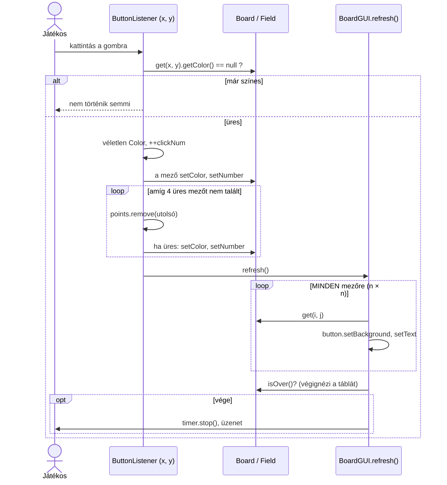
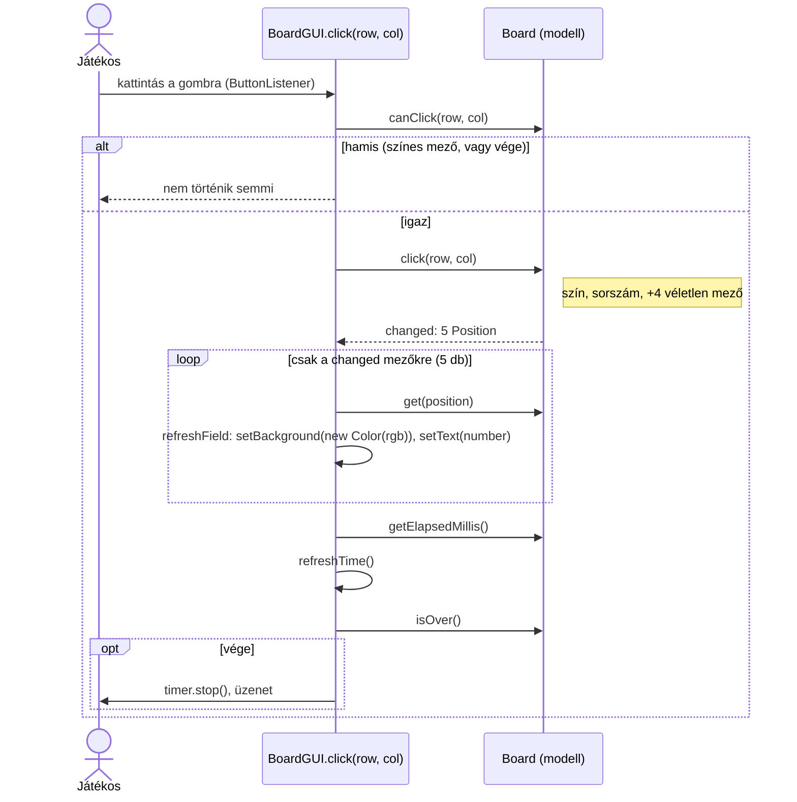

# 8. hét – Táblás játék: csak azt frissítsük, ami változott; a 2. beadandó mintamegoldása

Ezen a héten egy táblás ügyességi játékot, a **Color clickert** nézzük meg. A kiinduló változat működik, de minden kattintás után a **teljes táblát** újrarajzolja. A hét feladata az **optimalizált változat**: csak azokat a gombokat frissítjük, amelyeknek az állapota megváltozott. Közben a programot a 7. héten tanult **modell–nézet** (MV) szerkezetbe is átrendezzük, mert az optimalizáláshoz a modellnek meg kell tudnia mondani, mi változott. Végül egy teljes **minta beadandót** nézünk meg a 2. feladatsor 1. feladatához (potyogós amőba), tesztekkel és dokumentációval.

## Áttekintés

| Mappa                   | Típus          | Téma                                                                                                                  |
| ----------------------- | -------------- | --------------------------------------------------------------------------------------------------------------------- |
| `Colorclicker`          | Példa          | Color clicker, **kiinduló változat**: a szabályok a GUI-ban, minden kattintás után a teljes tábla frissül              |
| `ColorclickerOptimized` | Feladat        | Ugyanez **MV-ben és optimalizálva**: a `Board` modell megmondja, mely mezők változtak, a nézet csak azokat frissíti; JUnit tesztek |
| `Amoba`                 | Minta beadandó | **Potyogós amőba**, a 2. beadandó 1. feladata: teljes megoldás MV-ben, tesztekkel, UML-lel, dokumentációval: [`Amoba/README.md`](Amoba/README.md) |

A két Color clicker **kívülről ugyanaz**: ugyanaz az ablak, ugyanúgy játszható. A különbség a kód szervezése, és hogy kattintásonként 5 vagy 400 gombot rajzolunk újra.

**Új ezen a héten:** a projektek **Maven-projektek** (mint a 6. heti `calcMVC`), nem NetBeans Ant-projektek. Ezért NetBeansben és **IntelliJ IDEA-ban** is ugyanúgy megnyithatók, és parancssorból is fordulnak (ld. [Futtatás](#futtatás)). A beadandót is érdemes így készíteni: az oktató bármelyik IDE-vel meg tudja nyitni.

## A játék – Color clicker

Egy n × n-es tábla gombokból áll, induláskor mind üres. Egy üres gombra kattintva a gomb és **még 4 véletlenszerűen választott üres gomb** ugyanazt a véletlen színt kapja, és a kattintás sorszáma kerül rájuk feliratnak. Már színes gombra kattintani hatástalan. A játék akkor ér véget, amikor minden gomb színes; a program kiírja, mennyi idő kellett hozzá. A *Game ▸ New* menüben 5×5, 10×10, 15×15 vagy 20×20 méretű tábla választható.

```
┌ Color clicker ─────────────────────────────┐
│ Game                                       │  ← menü: New ▸ 5x5 / 10x10 / 15x15 / 20x20, Exit
├────────────────────────────────────────────┤
│ [ 1 ] [   ] [ 2 ] [   ] [   ]              │
│ [   ] [ 2 ] [   ] [ 1 ] [   ]              │  ← a gombok: szín + a kattintás sorszáma
│ [ 1 ] [   ] [   ] [   ] [ 2 ]              │     (az 1-esek egyforma színűek, a 2-esek is)
│ [   ] [ 2 ] [ 1 ] [   ] [   ]              │
│ [   ] [   ] [   ] [ 2 ] [ 1 ]              │
├────────────────────────────────────────────┤
│                                    1234 ms │  ← az eltelt idő, 10 ms-onként frissül (Timer)
└────────────────────────────────────────────┘
```

## Kiinduló változat – mi történik egy kattintásra?

**Projekt:** `Colorclicker`

| Osztály           | Feladat                                                                                            |
| ----------------- | -------------------------------------------------------------------------------------------------- |
| `Colorclicker`    | belépési pont, az EDT-n létrehozza a felületet                                                     |
| `Field`           | egy mező: szín (`java.awt.Color`, `null` ha üres) és sorszám                                       |
| `Board`           | a mezők n × n-es tömbje; `isOver()` végignézi, színes-e mind                                       |
| `BoardGUI`        | a gombrács, az óra, **és a szabályok**: az eseménykezelő dönti el, mi színeződik ki; a `refresh()` minden gombot újrarajzol |
| `ColorClickerGUI` | az ablak és a menü; új játéknál új `BoardGUI`-t tesz az ablakba                                    |

A kattintás útja (`BoardGUI.ButtonListener.actionPerformed`):



Lépésről lépésre:

1. Az eseménykezelő megnézi, üres-e a mező. Ha nem, nem történik semmi.
2. Kisorsol egy színt, növeli a kattintásszámlálót, és beállítja a mezőt.
3. Az induláskor megkevert `points` lista végéről addig vesz le mezőket, amíg 4 üreset nem talál; ezeket is beállítja.
4. Meghívja a `refresh()`-t, ami **minden** gombon beállítja a hátteret és a feliratot, majd a `Board.isOver()`-rel **végignézi a táblát**, és a végén üzenetet mutat.

Mi a gond ezzel?

- **Felesleges munka.** Egy kattintásra 5 mező változik, de a `refresh()` n² gombot állít be. A `setBackground` és a `setText` mindegyike újrarajzolást kér; 20 × 20-on ez 800 hívás kattintásonként 10 helyett. Az `isOver()` is n² mezőt néz végig minden kattintásra, pedig elég lenne számolni az üres mezőket.
- **A szabályok a nézetben vannak.** Hogy 4 mező színeződik ki, hogy a szín véletlen, hogy a sorszám nő: mind az eseménykezelőben van. Ezért JUnit teszt nem írható rájuk, csak kattintgatva próbálhatók ki.
- **A modell az AWT-től függ.** A `Field` `java.awt.Color`-t, a `Board` `java.awt.Point`-ot használ.
- **Apróbb hibák.** Új játéknál a régi `BoardGUI` órája (`Timer`) tovább jár, és a régi táblát a memóriában tartja. Ha a tábla mezőinek száma nem lenne osztható 5-tel (pl. 7 × 7), a `points` lista az utolsó kattintásnál kiürülne, és a program kivétellel leállna. A menüben csak 5-tel osztható méretek vannak, ezért ez nem jön elő, de a hiba ott van.

## Optimalizált változat – MV, és csak a változott gombok

**Projekt:** `ColorclickerOptimized`

| Osztály           | Réteg  | Feladat                                                                                           |
| ----------------- | ------ | ------------------------------------------------------------------------------------------------- |
| `Colorclicker`    | –      | belépési pont                                                                                     |
| `Position`        | modell | egy mező helye: sor, oszlop (rekord); a `java.awt.Point` helyett                                   |
| `Field`           | modell | egy mező: sorszám (0 = üres) és szín **egész számként** (0xRRGGBB); csak a `Board` színezheti ki   |
| `Board`           | modell | a tábla, a kattintások száma, az üres mezők száma, az idő, **és a szabályok**: a `click` visszaadja, mely mezők változtak |
| `BoardGUI`        | nézet  | a gombrács és az óra; az eseménykezelő a modellt hívja, és **csak a visszakapott mezők gombjait** frissíti |
| `ColorClickerGUI` | nézet  | az ablak és a menü; új játéknál leállítja a régi órát                                              |
| `BoardTest`       | teszt  | 19 JUnit teszt a modellhez                                                                        |

### A modell

| Művelet / lekérdezés            | Mit csinál                                                                                                      |
| ------------------------------- | --------------------------------------------------------------------------------------------------------------- |
| `Board(size)`, `Board(size, random)` | új, üres tábla; a tesztek rögzített magú `Random`-ot adnak, így a "véletlen" kiszámítható                  |
| `canClick(row, col)`            | lehet-e a mezőre kattintani: tart a játék, és a mező üres                                                       |
| `click(row, col)`               | a kattintás szabálya; **visszaadja a kiszínezett mezők helyét** (a kattintott mező + legfeljebb 4 véletlen üres); ha nem lehet kattintani, `IllegalStateException` |
| `isOver()`                      | minden mező színes (az üres mezők számlálója 0, nem kell a táblát végignézni)                                   |
| `getElapsedMillis()`            | az eltelt idő; a játék vége után nem változik                                                                   |
| `get(row, col)`, `get(Position)`, `getSize()`, `getClickCount()`, `getEmptyCount()`, `emptyPositions()` | lekérdezések                            |

A kulcs a `click` visszatérési értéke. A modell pontosan tudja, mely mezőket módosította, ezért ezt egy listában visszaadja. A nézetnek nem kell kitalálnia, mi változott:

```java
public List<Position> click(int row, int col) {
    if (!canClick(row, col)) {
        throw new IllegalStateException(...);
    }
    clickCount++;
    int rgb = random.nextInt(COLOR_COUNT);              // 0x000000 .. 0xFFFFFF

    List<Position> changed = new ArrayList<>();
    changed.add(new Position(row, col));                // a kattintott mező
    List<Position> empty = emptyPositions();
    empty.remove(new Position(row, col));
    Collections.shuffle(empty, random);
    changed.addAll(empty.subList(0, Math.min(EXTRA_FIELDS, empty.size())));   // + legfeljebb 4

    for (Position position : changed) {
        get(position).color(clickCount, rgb);
        emptyCount--;
    }
    if (emptyCount == 0) {
        endTime = System.currentTimeMillis();
    }
    return changed;
}
```

Figyeljük meg:

- A **szín egy egész szám** (`0xRRGGBB`, mint a CSS-ben a `#RRGGBB`), nem `java.awt.Color`. A modellben így egyetlen AWT-import sincs, a nézet a `new Color(rgb)` hívással készít belőle színt. (A `Color` csak egy értékosztály, nem komponens, de a "modellben nincs `java.awt`" szabályt egyszerűbb betartani, mint kivételeket tanulni hozzá.)
- A `Math.min(EXTRA_FIELDS, empty.size())` miatt a játék végén, ha 4-nél kevesebb üres mező maradt, azok színeződnek ki: a 7 × 7-es tábla is működne.
- A **kattintásra alkalmatlan mező** (már színes, vagy vége a játéknak) a `canClick`-kel kérdezhető le, és a `click` kivételt dob rá. A nézet előbb kérdez, és csak akkor hív. Ez ugyanaz a minta, mint a 7. heti `requireCurrentCard`.

### A nézet – a kattintás útja



```java
private void click(int row, int col) {
    if (!board.canClick(row, col)) {
        return;
    }
    List<Position> changed = board.click(row, col);
    for (Position position : changed) {       // az optimalizálás: csak ezek
        refreshField(position);
    }
    refreshTime();
    if (board.isOver()) {
        timer.stop();
        JOptionPane.showMessageDialog(...);
    }
}
```

A `refreshField(position)` az **egyetlen** hely, ahol a nézet egy mező állapotát olvassa; a `refreshAll()` csak induláskor fut, és ugyanezt hívja minden mezőre. Így az "optimalizált" és a "teljes" frissítés ugyanazt a kódot használja, nem lehet eltérés köztük.

### Mennyit nyerünk?

Kattintásonként ennyi gombot állítunk be (`setBackground` + `setText`):

| Tábla   | Kiinduló (`refresh()`) | Optimalizált (`refreshField` × changed) |
| ------- | ---------------------- | --------------------------------------- |
| 5 × 5   | 25                     | 5                                       |
| 10 × 10 | 100                    | 5                                       |
| 15 × 15 | 225                    | 5                                       |
| 20 × 20 | 400                    | 5                                       |

Egy ekkora táblánál a különbség szemmel még nem látszik, a Swing gyors. Az elv viszont általános: **a nézet azt frissítse, ami változott, és ezt a modell mondja meg.** A beadandó játékainál ugyanez: egy lépés után elég a lépésben érintett mezők gombjait frissíteni (az `Amoba` `drop` metódusa például visszaadja, hova esett a jel). Ha viszont a teljes tábla változhat (pl. a Rubik tábla egy sora), akkor a teljes frissítés a helyes.

### Mi változott még?

| | `Colorclicker` | `ColorclickerOptimized` |
| --- | --- | --- |
| A szabályok helye | `BoardGUI.ButtonListener` | `Board.click` |
| Mi változott? | a nézet nem tudja, mindent frissít | a `click` visszaadja a mezők listáját |
| A mező helye | `java.awt.Point` | `Position` rekord |
| A szín | `java.awt.Color` a modellben | `int` a modellben, `Color` a nézetben |
| Vége a játéknak? | n² mező végignézése | üres mezők számlálója |
| Az idő | a nézet méri | a modell méri, a vége után megáll |
| Új játék | a régi `Timer` tovább jár | `boardGUI.stop()` |
| 4-nél kevesebb üres mező | kivétel (ha a méret nem 5-tel osztható) | a maradék színeződik ki |
| Tesztelhetőség | csak kattintgatva | 19 JUnit teszt |

### Tesztek

`src/test/java/colorclicker/BoardTest.java`: az új tábla; egy kattintás (a kattintott mező + 4, egyforma szín és sorszám, a mezők különbözők); **pontosan a visszaadott mezők változnak** (a tábla többi része érintetlen); sorszámozás; szabálytalan kattintás (`canClick`, kivétel, a sikertelen kattintás nem változtat semmit); a játék vége (2 × 2-es táblán egy kattintás a 3 maradék mezőt színezi; 5 × 5-ön pontosan 5 kattintás; 1 × 1); az idő (nem negatív, a vége után áll).

A tesztek `new Random(42)`-vel hozzák létre a táblát: a rögzített mag miatt a "véletlen" színek és mezők minden futtatáskor ugyanazok, a teszt kiszámítható.

## Minta beadandó – Potyogós amőba

**Projekt:** `Amoba`, leírás: [`Amoba/README.md`](Amoba/README.md)

A 2. beadandó feladatsor 1. feladatának teljes megoldása. Azt mutatja meg, hogyan néz ki egy beadásra kész játék:

- **modell** Swing nélkül (`Board`: potyogás és négyes keresése; `Game`: ki következik, lépés, vége, győztes), **nézet** (`AmobaGUI`), ami csak megjelenít és továbbít;
- a lépés után **csak az egy változott gomb** frissül (a `drop` visszaadja, hova esett a jel): a Color clicker tanulsága;
- **43 JUnit teszt**, köztük a feladat minden szabályára egy;
- **dokumentáció** a feladatlap elvárásai szerint: a feladat elemzése, a program szerkezete UML osztálydiagrammal, esemény–eseménykezelő párosítások, szekvencia- és állapotdiagram, a tesztek, a futtatás.

A négyes vízszintesen, függőlegesen vagy átlósan nyer, mint a közismert játékban. Az irányok a modellben egyetlen tömbben vannak (`Board.DIRECTIONS`), egy irány elhagyása vagy felvétele egyetlen sor, és egy teszt dokumentálja.

## A 2. beadandó – közös követelmények és tippek

A feladatlap közös követelményei, és hogy a mintában hol vannak megoldva:

| Követelmény | Hogyan |
| --- | --- |
| Felhasználóbarát, könnyen kezelhető | gombtábla, menü, állapotsor (ki következik, lépésszám); a szabálytalan kattintás hatástalan, nem hibaüzenet |
| Objektumorientált megoldás; a többrétegű felépítés nem kötelező, de **erősen ajánlott** | modell–nézet: a szabályok tesztelhetők, a nézet egyszerű (ld. a 7. hét) |
| Az ablak mérete igazodjon a táblához | a gombrács újraépítése után `frame.pack()` (`AmobaGUI.newGame`) |
| Új játék a méret megadásával | `enum` a méreteknek, a menü a `values()`-ból épül; `newGame(size)` |
| A játék végének felismerése, a győztes kiírása, **automatikus új játék** | a modell `isOver()`/`getWinner()`, a nézet `JOptionPane` után `newGame()` és teljes frissítés |
| Dokumentáció: a feladat elemzése, a program szerkezete **UML osztálydiagrammal**, esemény–eseménykezelő párosítások, a tevékenységek leírása | [`Amoba/README.md`](Amoba/README.md) 1., 2.3, 3. szakasz; a diagramok Mermaidben, a forrás az `uml/` mappában |
| Tesztek (a prezentáción kérdezzük) | JUnit a modellhez, a szabályonként egy teszt |

Tippek az egyes feladatokhoz (mi a **modell állapota**, mi a **lépés**, mikor van **vége**):

| # | Feladat | A modell állapota | A lépés | A vége | Mire figyeljünk |
| --- | --- | --- | --- | --- | --- |
| 1 | Potyogós amőba | `Player[][]`, ki következik | `drop(col)`: a legalsó üres mezőre | 4 vízszintesen/függőlegesen/átlósan; tele tábla | ld. a mintát |
| 2 | Kitolás | `Player[][]` (kavicsok), a kiválasztott kavics, a hátralévő lépések | kiválasztás, majd irány: a sorban/oszlopban a kavicsok eltolódnak, a szélső lekerül | elfogy az 5n lépés; több kavics nyer | két kattintásból áll egy lépés: a modell tárolja, van-e kiválasztott kavics; a véletlen kezdőállást `Random`-mal, teszthez rögzített maggal |
| 3 | Vadászat | a menekülő és a 4 támadó helye, ki következik, a lépések száma | kiválasztott figura + szomszédos üres mező | a menekülő nem tud lépni (4n lépésen belül) | "nem tud lépni" = a 4 szomszédja foglalt vagy a tábla széle; a lépésszámot **folyamatosan** ki kell írni |
| 4 | Kiszúrós amőba | `Player[][]`, ki következik | jel egy üres mezőre, majd a kiszúrás: 3-asnál 1, 4-esnél 2 saját jel törlése véletlen helyről | 5 egymás mellett; tele tábla | a leghosszabb sor hosszát kell megállapítani (nem csak "van-e 4"); a törlés után újra kell frissíteni a törölt mezőket is: a lépés adja vissza a változott mezők listáját |
| 5 | Fekete lyuk | az űrhajók helye színenként, a lyuk helye, ki következik, hány hajó jutott a lyukba | kiválasztott hajó + irány: addig csúszik, amíg szél/lyuk/másik hajó nem állítja meg | az egyik játékos hajóinak fele a lyukban | a csúszás egy ciklus a modellben; a lyukba érő hajó eltűnik a tábláról |
| 6 | 4-es játék | `int[][]` értékek (0–4), ki billentette 4-re (`Player[][]`), pontok | egy mező + 4 szomszédja +1 (ha < 4); aki 4-re állít, pontot kap | minden mező 4 | a lépés 5 mezőt változtathat; a pontokat **folyamatosan** kiírni |
| 7 | Áttörés | `Player[][]` bábuk, ki következik, a kiválasztott bábu | kiválasztás, majd cél: előre egyenesen/átlósan üresre, átlósan ütve | egy bábu elérte a túlsó sort | a két játékos ellentétes irányba lép: az "előre" a játékostól függ |
| 8 | Lovagi torna | lovak helye, a mezők színe, ki következik | kiválasztott ló + L-alakú cél | minden mező színes; 4 egyforma szín egymás mellett | a L-lépés 8 lehetséges célja; a négyes keresése mint az amőbában, de színekre |
| 9 | Rubik tábla | `int[][]` színek, lépésszám | egy sor vagy oszlop ciklikus eltolása | minden sor vagy minden oszlop egyszínű | a kezdőállás keverés **érvényes lépésekkel** (véletlen sor-/oszloptolásokkal a kész állásból), így biztosan kirakható; itt a **teljes** sor/oszlop változik, azt kell frissíteni |
| 10 | Rubik óra | 9 óra állása (1–12), lépésszám | egy gomb: a 4 szomszédos óra +1 | mind a 9 óra 12-t mutat | 3 × 3 óra + 4 gomb közöttük: `GridLayout` nem elég, két rács vagy egy 5 × 5-ös rács a kettő közé; a 12 után 1 jön (`% 12`) |

Általános tanácsok:

- **Először a modell.** Írjuk meg a `Board`/`Game` osztályt és a tesztjeit, mielőtt egyetlen gombot létrehoznánk. Ha a modell "parancssorból játszható", a felület már csak rajzol.
- **A lépés adja vissza, mi változott** (egy `Position`, vagy egy `List<Position>`), és a nézet azt frissítse. Ahol a teljes tábla változhat, ott `refreshAll()`.
- **Két kattintásos lépéseknél** (kiválasztás, majd cél: 2., 3., 5., 7., 8. feladat) a kiválasztott figura a **modell** állapota (`selected`), nem a nézeté. A nézet csak jelöli (pl. keret), és minden kattintás után a modellből frissít.
- **Véletlen a modellben:** a `Random`-ot a konstruktor kapja, a teszt rögzített maggal adja (`new Random(42)`), így a "véletlen" is tesztelhető (ld. `ColorclickerOptimized`).
- **A játék vége után** a modell ne fogadjon el lépést (`canDrop`/`canMove` hamis, a művelet kivételt dob); a nézet az üzenet után `newGame()`-et hív és mindent frissít.
- **Ne tároljuk kétszer** ugyanazt (pl. a nézetben is egy `currentPlayer` mezőt): előbb-utóbb eltér a modelltől.
- **Dokumentáció:** a README-ben legyen benne az elemzés, az osztálydiagram, az esemény-táblázat, a tesztek és a futtatás. A Mermaid-diagramokat a GitHub megjeleníti; képpé a [mermaid.live](https://mermaid.live) oldalon vagy a `mermaid-cli`-vel alakíthatók.
- **A következő szint:** ha a modell observer-mintával értesítené a nézetet (6. heti `calcMVC`), a `refresh` hívásokat sem kellene kézzel kiírni. A beadandóhoz az MV és a kézi frissítés bőven elég.

## Futtatás

A projektekhez **JDK 17 vagy újabb** kell. Mindhárom projekt sima Maven-projekt: IDE-specifikus projektfájl nem kell hozzájuk, és a JUnit jar-t a Maven tölti le (az első fordításhoz internet kell).

- **NetBeans:** *File ▸ Open Project* → a projekt mappája (ahol a `pom.xml` van) → **F6** (Run Project). Az `nbactions.xml` megmondja a főosztályt. Tesztek: **Alt+F6** (Test Project); az eredmény a *Test Results* ablakban.
- **IntelliJ IDEA:** *File ▸ Open* → a projekt mappája → *Open as Project* → *Trust Project*. A futtatási konfiguráció (a projekt neve) a `.run/` mappából magától megjelenik a felső eszköztáron, **Shift+F10** indítja. Tesztek: az `src/test/java` mappán jobb klikk ▸ *Run 'All Tests'*. Ha az IntelliJ nem találja a JDK-t: *File ▸ Project Structure ▸ Project ▸ SDK*.
- **Parancssorból** (a projekt mappájából):

  ```
  mvn compile exec:java        # futtatás
  mvn test                     # tesztek (ColorclickerOptimized: 19, Amoba: 43)
  mvn package                  # target/<projekt>-1.0-SNAPSHOT.jar
  java -jar target/ColorclickerOptimized-1.0-SNAPSHOT.jar
  ```

  Ha nincs `mvn` a PATH-on, a NetBeans sajátja is jó: Windowson `"C:\Program Files\Apache NetBeans\java\maven\bin\mvn.cmd"`, macOS-en `"/Applications/Apache NetBeans.app/Contents/Resources/netbeans/java/maven/bin/mvn"`.

  Maven nélkül, csak `javac`-kal (a tesztek nélkül):

  ```
  javac -encoding UTF-8 -d target/classes src/main/java/colorclicker/*.java
  java -cp target/classes colorclicker.Colorclicker
  ```

## Tippek

- Az optimalizálás **nem a nézet ügyessége**, hanem a modell felelőssége: a modell tudja, mit változtatott, mondja is meg. Ha a nézetnek "ki kell találnia", mi változott (pl. összehasonlítja a régi és az új állapotot), valami nem a helyén van.
- Egy frissítő metódus **egy mezőre** (`refreshField`), és a teljes frissítés ezt hívja ciklusban. Így a kétféle frissítés nem térhet el egymástól.
- A modellben a **"lehet-e?" kérdés és a művelet** külön metódus (`canClick` / `click`, `canDrop` / `drop`). A nézet kérdez, a modell dönt, és a művelet kivétellel jelzi, ha mégis szabálytalanul hívták.
- A `Timer` a nézeté (Swing), de amit mér vagy számol, az a modellé. Új játéknál a régi `Timer`-t **le kell állítani**.
- A modellben egyetlen `javax.swing` vagy `java.awt` import sem lehet. Ha egy szín vagy pont kell a modellbe, tároljuk számként vagy saját rekordban.
